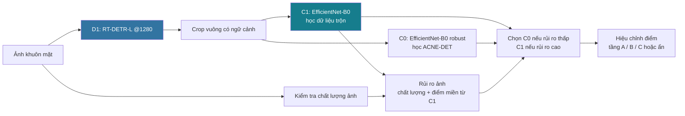
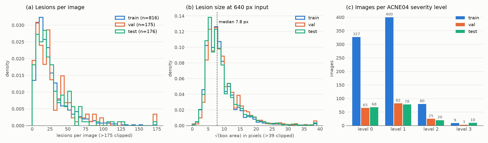
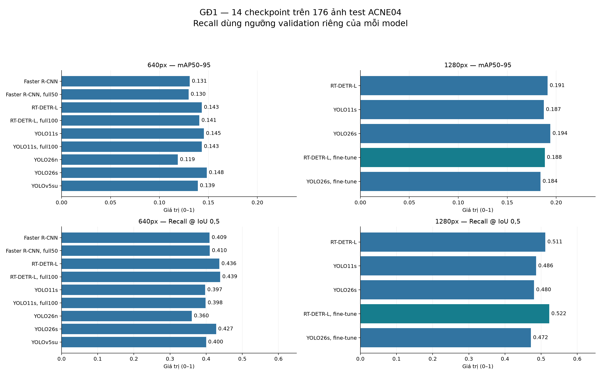
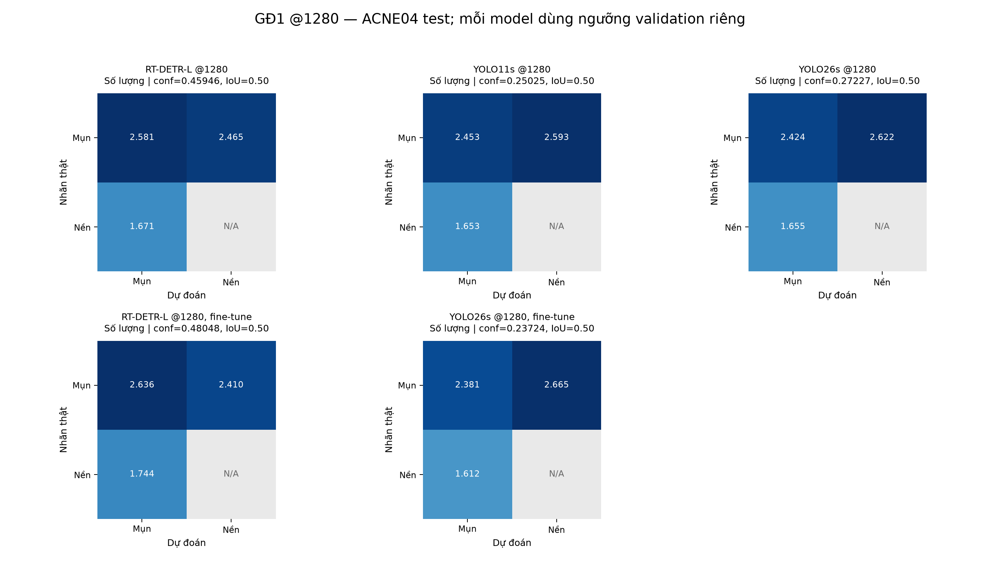
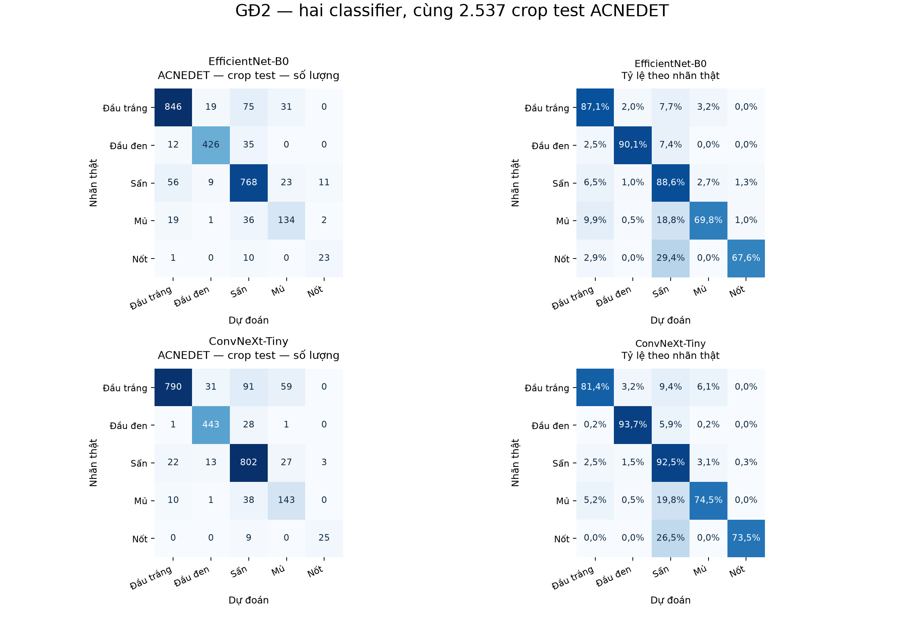
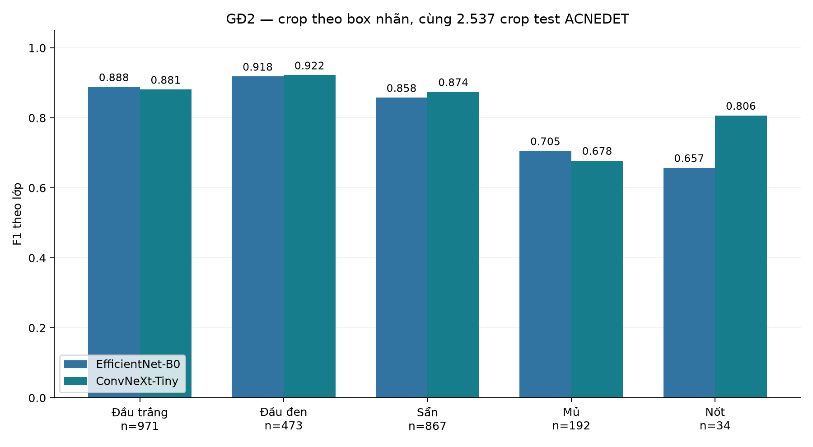
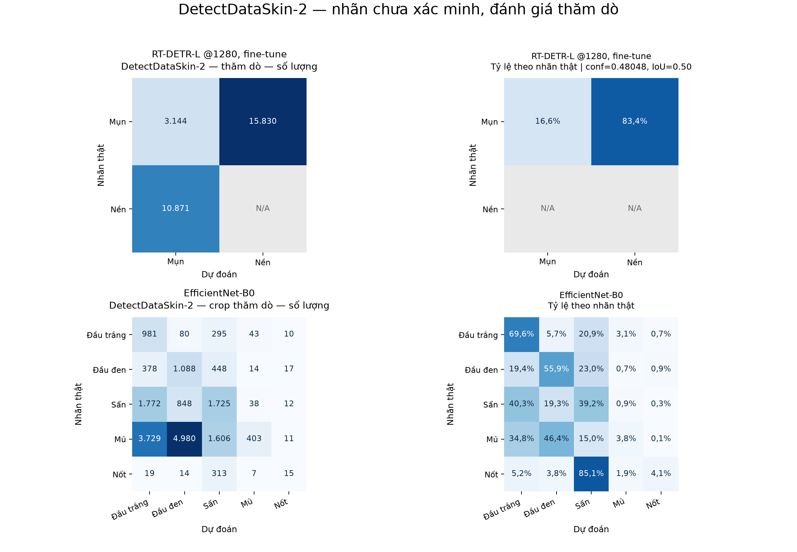
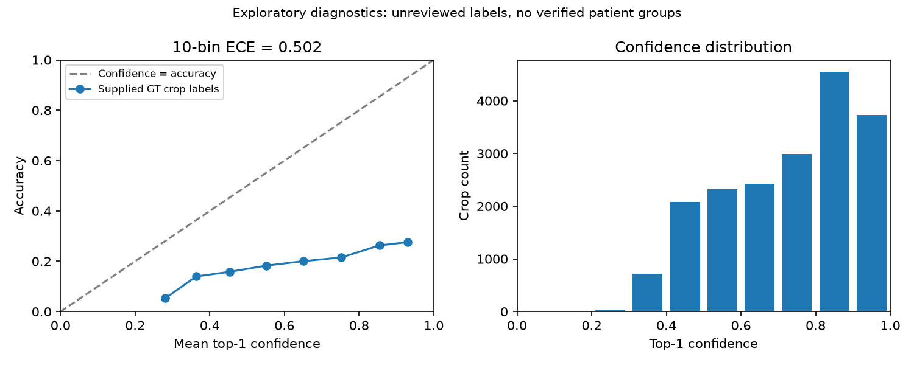

<div align="center">

# BinSpa AI

### Phát hiện vị trí mụn và phân loại mụn trên ảnh khuôn mặt

**Báo cáo thực nghiệm · Pipeline 2 giai đoạn · Benchmark 3 detector × 2 classifier**

[](requirements-phase1-lock.txt)
[](requirements-phase1-lock.txt)


[Kết quả tổng hợp](reports/publication/README.md) · [Số liệu JSON](reports/publication/metrics.json) · [PDF 18 ma trận](docs/figures/research/confusion_matrices/all_models_confusion_matrices.pdf) · [Chính sách công bố](docs/PRIVACY.md) · [Kế hoạch tăng độ tin cậy](docs/RELIABILITY_PLAN.md) · [Model card selfie_v1](reports/publication/MODEL_CARD_selfie_v1.md)

</div>

> **Phạm vi:** đây là nguyên mẫu nghiên cứu kỹ thuật, chưa được kiểm định lâm sàng. Accuracy trên crop có nhãn không đại diện cho độ chính xác của toàn bộ hệ thống trên selfie. Các nhãn và ID bệnh nhân của tập thăm dò chưa được xác minh độc lập.

## Tóm tắt

**Cập nhật 08/11/2026:** đã hoàn thành `bench_v1`, so sánh **YOLO26s, RT-DETR-L, Faster R-CNN × EfficientNet-B0, ConvNeXt-Tiny**. Pipeline **YOLO26s + ConvNeXt-Tiny** là ứng viên duy nhất đạt mọi điều kiện precision theo nguồn trên `val_select`, nên được chọn theo quy tắc đã khóa. Đây là lựa chọn của benchmark, **chưa thay thế pipeline demo**.

**Demo vẫn dùng RT-DETR-L + 2×EfficientNet-B0 (định tuyến theo miền ảnh).** Trên T1, recall vị trí của RT-DETR-L + 2×EfficientNet-B0 là **40,4%**, còn pipeline được chọn đạt **36,2 ± 1,5%**; số nhãn đúng/ảnh gần bằng nhau (**4,98** so với **4,96 ± 1,88**). Pipeline mới ít hiện tên loại và coverage dao động lớn giữa seed, nên giữ RT-DETR-L + 2×EfficientNet-B0 cho demo. [Xem kết quả mới và quyết định sử dụng](#41-bench_v1--kết-quả-mới-nhất-08112026).

BinSpa AI dùng kiến trúc có sẵn; đóng góp của dự án nằm ở chuẩn bị dữ liệu, so sánh thực nghiệm, kiểm tra artifact và phân tích giới hạn khi chuyển miền. Các bảng 14 checkpoint detector và hai classifier ở đợt trước được giữ dưới nhãn **kết quả lịch sử**, không dùng số crop accuracy 86,60% để mô tả toàn pipeline hiện tại.

RT-DETR-L + 2×EfficientNet-B0 hiển thị theo tầng: tên loại → nhóm viêm/không viêm → chỉ vị trí. Precision của phần được ghi tên loại là **91,9%** trên T1 (ACNE-DET, nhãn bác sĩ) và **83,5%** trên T2 (ảnh thường, nhãn chưa xác minh). Đây không phải accuracy toàn bộ ảnh. T1–T4 đã được dùng trong quá trình phát triển; chưa có kiểm định độc lập mới trên selfie có nhãn chuyên gia. [Số liệu tổng hợp](reports/publication/metrics.json) có khóa `bench_v1`; [model card](reports/publication/MODEL_CARD_selfie_v1.md) mô tả mốc demo P11.

## Mục lục

1. [Bài toán và kiến trúc](#1-bài-toán-và-kiến-trúc)
2. [Dữ liệu và cách chia tập](#2-dữ-liệu-và-cách-chia-tập)
3. [Phương pháp và giao thức đánh giá](#3-phương-pháp-và-giao-thức-đánh-giá)
4. [Kết quả bench_v1 và các đợt trước](#4-kết-quả-bench_v1-và-các-đợt-trước)
5. [Đánh giá thăm dò DetectDataSkin-2 — đợt lịch sử](#5-đánh-giá-thăm-dò-detectdataskin-2--đợt-lịch-sử)
6. [Thảo luận và hạn chế](#6-thảo-luận-và-hạn-chế)
7. [Cài đặt và tái lập](#7-cài-đặt-và-tái-lập)
8. [Công bố dữ liệu và quyền sử dụng](#8-công-bố-dữ-liệu-và-quyền-sử-dụng)
9. [Tài liệu tham khảo](#9-tài-liệu-tham-khảo)

## 1. Bài toán và kiến trúc

GĐ1 nhận ảnh khuôn mặt. GĐ2 nhận crop tổn thương, từ box có nhãn khi benchmark classifier hoặc từ box GĐ1 khi chạy pipeline thực tế. RT-DETR-L + 2×EfficientNet-B0 dùng một detector và hai classifier train riêng; kết quả classifier được chọn theo rủi ro của **cả ảnh**, không lấy trung bình hai dự đoán.



*Hình 1. Luồng suy luận của RT-DETR-L + 2×EfficientNet-B0. Code tính cả C0 và C1; bộ định tuyến chọn kết quả, không train một mạng end-to-end mới. Đánh giá từng model và đánh giá pipeline là hai bài toán khác nhau.*

| Thành phần đang dùng trong RT-DETR-L + 2×EfficientNet-B0 | Vai trò | Checkpoint / cấu hình cục bộ |
| --- | --- | --- |
| **D1 — RT-DETR-L @1280** | Tìm vùng nghi mụn; detector confidence 0,30 | `models/candidates/selfie_v1/hyb_d1/detector.pt` (`675ad751…`) |
| **C0 — EfficientNet-B0 robust @224** | Loại mụn trên ảnh rủi ro thấp | `models/phase2/best_acne_type_robust.pth` (`5dd4daff…`) |
| **C1 — EfficientNet-B0 @224, dữ liệu trộn** | Loại mụn trên ảnh rủi ro cao; đặc trưng đánh giá miền | `models/candidates/selfie_v1/hyb_d1/classifier.pth` (`6e6f2123…`) |
| Policy và thống kê miền | Hiệu chỉnh điểm, định tuyến, ngưỡng A/B/C | `models/candidates/selfie_v1/hyb_d1/{display_policy.json,domain_stats.npz}` |

Policy được chọn trong `configs/selfie_v1/serving.json`. Ngưỡng A/B/C cho ảnh rủi ro thấp lần lượt **0,82 / 0,86 / 0,43**; nhóm cao **0,71 / tắt / 0,53**. Đây là điểm đã hiệu chỉnh, không phải softmax đơn thuần. Hai classifier vẫn dự đoán năm lớp, nhưng policy không hiện tên `nodule` ở tầng A vì chưa đủ bằng chứng. Ngưỡng loại 80% của engine legacy không điều khiển RT-DETR-L + 2×EfficientNet-B0.

## 2. Dữ liệu và cách chia tập

### 2.1 Các tập dữ liệu

Bảng dưới mô tả các split **lịch sử** dùng cho các bảng GĐ1/GĐ2 và thăm dò cũ. `selfie_v1` và `bench_v1` dùng registry/lineage và vai trò riêng ở mục 2.4; không suy diễn rằng DetectDataSkin-2 chưa từng được dùng train ở các giai đoạn sau.

| Nguồn | Vai trò | Train / validation / test | Quy mô test |
| --- | --- | --- | --- |
| ACNE04, nhãn ACNE04-v2 | Detector mụn GĐ1 | 816 / 175 / 176 ảnh | 5.046 box mụn |
| Mirror ACNEDET trên Roboflow | Classifier GĐ2; phần train dùng thêm cho fine-tune GĐ1 | 190 / 40 / 45 ảnh | 2.537 crop mụn |
| DetectDataSkin-2 | Thăm dò với checkpoint và ngưỡng cố định | Không dùng train hoặc chọn ngưỡng | 1.275 ảnh; 18.974 box mụn; 18.846 crop có mapping nhãn hỗ trợ |

ACNE04 và ACNE04-v2 dùng chung nguồn ảnh, không phải hai cohort độc lập. Sau ghép nhãn, cách ly ảnh có lỗi và loại trùng chính xác trước chia tập, bản ACNE04 dùng trong dự án còn **1.167 ảnh, 31.498 tổn thương**. Nguồn ảnh được giới thiệu trong [Wu et al., ICCV 2019](https://openaccess.thecvf.com/content_ICCV_2019/papers/Wu_Joint_Acne_Image_Grading_and_Counting_via_Label_Distribution_Learning_ICCV_2019_paper.pdf); nguồn nhãn v2 được liên kết từ [AcneAI, MICCAI 2024](https://papers.miccai.org/miccai-2024/042-Paper2216.html).

Mirror ACNEDET có **275 ảnh và 31.502 annotation** thuộc nhiều lớp. Dự án chỉ dùng năm lớp mụn cho GĐ2. Các nguồn được chuẩn bị riêng; ảnh không được phân phối lại trong bản công khai.



*Hình 2. Phân bố số tổn thương, kích thước tổn thương và mức độ mụn của bản ACNE04 đã chuẩn bị. Kích thước nốt trung vị khoảng 7,8 pixel ở đầu vào 640; đây là bài toán vật thể nhỏ.*

### 2.2 Đơn vị chia tập và nguy cơ rò rỉ

- ACNE04 được chia theo ảnh sau loại trùng SHA256, seed 42. Không có ID bệnh nhân đã xác minh.
- ACNEDET dùng master split đã khóa cho GĐ2. Có 50 nhóm suy đoán từ thứ tự ảnh và độ giống ảnh; train/val/test có 34/8/8 nhóm. Đây **không phải xác nhận độc lập theo bệnh nhân**.
- Mọi crop kế thừa split của ảnh gốc. Crop từ cùng ảnh không đi sang split khác.
- Fine-tune GĐ1 dùng 816 ảnh train ACNE04 và 190 ảnh train ACNEDET. Phần test không nằm trong tập train; các tập test đã được xem qua nhiều bước nghiên cứu nên không còn là cohort mới hoàn toàn cho thử nghiệm tương lai.

### 2.3 Phân bố lớp GĐ2

| Lớp | Diễn giải | Train | Validation | Test |
| --- | --- | ---: | ---: | ---: |
| `closed_comedo` | Mụn đầu trắng | 4.127 | 776 | 971 |
| `open_comedo` | Mụn đầu đen | 2.309 | 511 | 473 |
| `papule` | Sẩn | 3.773 | 899 | 867 |
| `pustule` | Mụn mủ | 879 | 196 | 192 |
| `nodule` | Nốt | 143 | 32 | 34 |
| **Tổng** | | **11.231** | **2.414** | **2.537** |

### 2.4 Dữ liệu cho selfie_v1 và bench_v1

- **Detector D1:** `datasets/selfie_v1/det_v1/`, **4.674 lượt ảnh train / 422 ảnh val**. Train trộn ACNE04-v2, ACNE-DET tác giả, DetectDataSkin-2 và phần xnbio không trùng; có bản giả lập điện thoại và lặp nguồn. Không coi 4.674 lượt ảnh là 4.674 người/ảnh nguồn độc lập.
- **Classifier C1:** `datasets/selfie_v1/crops_v1/`, **52.052 crop train / 6.095 crop val**. Train gồm 26.026 GT + 26.026 jitter; loại mụn từ ACNE-DET, DetectDataSkin-2 và kbm0q ghép về ACNE04. Nhãn nguồn Roboflow chưa được chuyên gia xác minh.
- **Benchmark:** `datasets/selfie_v1/bench_v1/` khóa danh sách train A/B/C lần lượt **824 / 1.015 / 4.674 lượt ảnh**. Validation được tách theo lineage thành **214 ảnh `val_select`** và **208 ảnh `val_cal`**, không có nhóm chung. Đây là phiên bản dữ liệu khác split GĐ1 lịch sử ở mục 2.1.
- **Crop benchmark:** `datasets/selfie_v1/crops_bench_v1/`, cùng pool GT + jitter + crop detector seed-42 R1 cho cả hai classifier; crop train chỉ lấy từ train. Validation classifier dùng crop GT thuộc `val_select`.
- **Đánh giá phát triển:** T1 có 45 ảnh ACNE-DET, nhãn bác sĩ; T2 có 284 ảnh nguồn ảnh thường, nhãn chưa xác minh; T3 là bảy biến đổi của T1; T4 là phân biệt ca mụn/không mụn trên SCIN. Các tập đã được xem ở giai đoạn trước, không phải cohort test mới.

## 3. Phương pháp và giao thức đánh giá

### 3.1 Huấn luyện và lựa chọn

Mục 3.1–3.3 ghi giao thức của các đợt lịch sử; cách train RT-DETR-L + 2×EfficientNet-B0 ở mục 3.4, giao thức `bench_v1` ở mục 3.5.

GĐ1 so sánh YOLO26n, YOLO26s, YOLO11s, YOLOv5su, Faster R-CNN và RT-DETR-L, gồm các run kiểm soát đủ lịch, chạy ở 1280 và fine-tune dữ liệu gộp. Ngân sách và lịch train khác nhau giữa các đợt; 14 checkpoint không đại diện cho 14 kiến trúc được tuning hoàn toàn ngang nhau.

GĐ2 so sánh EfficientNet-B0 và ConvNeXt-Tiny pretrained ImageNet. Crop vuông có cạnh `2 × max(w, h)`, tối thiểu 32 pixel, được cắt từ ảnh gốc, đưa về kích thước đầu vào 224 và chuẩn hóa theo checkpoint. Mỗi kiến trúc thử ba cấu hình; cấu hình đại diện chọn bằng validation macro-F1. EfficientNet-B0 được chọn trước bước test đại diện vì validation macro-F1 cao hơn.


### 3.2 Chỉ số và ma trận

| Bài toán | Chỉ số | Đơn vị và giao thức |
| --- | --- | --- |
| Detector mụn | mAP50, mAP50–95 | AP từ dự đoán confidence thấp; IoU 0,50:0,05:0,95 |
| Detector mụn | P, R, F1; TP, FP, FN | IoU 0,5; ngưỡng max-F1 chọn trên validation riêng từng model |
| Classifier | Accuracy, macro-F1, balanced accuracy | Top-1 trên crop từ box nhãn; không bao gồm lỗi bỏ sót của detector |

Các ma trận thống nhất **hàng = nhãn thật, cột = dự đoán**. Với detector, cột **Nền** là tổn thương bị bỏ sót; hàng **Nền** là dự đoán không ghép được nhãn. Ô nền–nền và tỷ lệ của hàng nền ghi **N/A** vì không xác định được mọi vùng âm tính đúng. Không suy ra specificity từ các ma trận này.

Ma trận GĐ1 được chuyển vị từ số nguyên đã lưu và đối chiếu TP/FP/FN. Ma trận GĐ2 được tính lại từ CSV top-1.

### 3.3 Độ bất định và môi trường

Bootstrap ghép cặp 1.000 lần theo **ảnh gốc** được dùng cho so sánh hai classifier. Không lấy từng crop làm mẫu độc lập. Vì nhóm bệnh nhân chưa được xác minh, khoảng tin cậy này vẫn không phải khoảng tin cậy theo bệnh nhân. Mỗi cấu hình chủ yếu dùng một seed; chưa đo đủ biến thiên huấn luyện.

Môi trường thực nghiệm: Windows, Python 3.12, PyTorch, torchvision, timm, Ultralytics; GPU RTX 5050 Laptop 8 GB. Phiên bản đã cài được lưu trong [file lock](requirements-phase1-lock.txt). Các lệnh tải pretrained cần kết nối mạng. Thời gian suy luận phụ thuộc thiết bị, batch và bước tiền xử lý.

### 3.4 Cách train RT-DETR-L và hai classifier EfficientNet-B0

| Thành phần | Khởi tạo và dữ liệu | Epoch thực chạy / trần; checkpoint được chọn | Thông số chính |
| --- | --- | --- | --- |
| D1, chặng ACNE04 | RT-DETR-L COCO → ACNE04-v2 | 78/100; best 58 | AdamW, LR 2e-4, batch 2, input 1280, patience 20 |
| D1, chặng kết hợp | Best chặng trước → ACNE04 + ACNE-DET train | 36/40; best 26 | AdamW, LR 1e-4, batch 2, patience 10 |
| D1, chặng dữ liệu trộn | Best chặng trước → `det_v1` | 15/15; best 13 | AdamW, LR 1e-4, weight decay 1e-4, batch 2, patience 6 |
| C0, robust cũ | ImageNet → 11.231 crop train ACNE-DET | 11/30; best 5 | AdamW, LR 3e-4, weight decay 0,05, batch 32, input 224, patience 6 |
| C1, dữ liệu trộn | ImageNet → `crops_v1` GT + jitter | 13/20; best 8 | AdamW, LR 3e-4, weight decay 0,05, batch 32, input 224, patience 5 |

Các thành phần trên dùng seed 42. C0/C1 train riêng, đều có label smoothing 0,1 và augmentation điện thoại xác suất 0,5; C1 dùng sampler cân bằng lớp theo nghịch đảo căn tần suất, C0 không dùng sampler. C1 được chọn bằng trung bình macro-F1 theo nguồn trên val; C0 dùng macro-F1 val. Sau đó mới ghép checkpoint và fit policy, không train chung một mạng mới. D1 chặng cuối mất 6,18 giờ, C1 khoảng 32,5 phút; các số này không phải thời gian train của `bench_v1`.

Cấu hình nguồn: `configs/selfie_v1/det_d1.yaml`, `cls_c1.yaml`, các `completed.json` của run tương ứng. Hiệu chỉnh và ngưỡng RT-DETR-L + 2×EfficientNet-B0 được chọn bằng val/OOF theo lineage ở P08/P11; khác cách tách `val_select`/`val_cal` của benchmark mới.

### 3.5 Giao thức thực chạy của bench_v1

- **Detector:** ba kiến trúc, COCO → A: ACNE04-v2 (**100 epoch / patience 20**) → B: thêm ACNE-DET (**40 / 10**) → C: dữ liệu trộn (**20 / 6**). Hai recipe R1/R2 ở seed 42; R2 giảm nửa learning rate. Chọn recipe bằng mAP50–95 trung bình nguồn trên `val_select`, R2 chỉ thay R1 nếu hơn 0,002. Cả ba giữ R1.
- **Classifier:** ImageNet, input 224, batch 32, AdamW, weight decay 0,05, label smoothing 0,1, sampler nghịch đảo căn tần suất lớp và augmentation điện thoại xác suất 0,5. Trần 30 epoch, patience 6. LR R1 EfficientNet **3e-4**, ConvNeXt **1e-4**; R2 giảm nửa. Chọn theo macro-F1 trung bình nguồn trên `val_select`; cả hai giữ R1.
- **Ba seed có phạm vi khác nhau:** detector seed **43/44 chỉ train lại chặng C từ checkpoint B của seed 42** cùng recipe. Classifier chạy riêng ở seed 42/43/44 trên cùng pool crop. Vì vậy ± của detector/pipeline **không đo biến thiên toàn bộ chuỗi A→B→C**.
- **Điều kiện so sánh:** cùng danh sách dữ liệu từng chặng, cạnh dài 1280, tối đa 300 box và evaluator. Tắt mosaic/mixup. Vẫn có khác biệt recipe: YOLO/RT-DETR dùng AdamW và nominal batch 64 của Ultralytics; Faster R-CNN dùng SGD, micro-batch 1, tích lũy 4 ảnh/step, anchor nhỏ và full backbone. Không gọi đây là thí nghiệm đồng nhất mọi optimizer/batch/augmentation.
- **Calibration và policy:** fit riêng từng pipeline trên `val_cal`, chọn ngưỡng qua dự đoán ngoài fold theo nhóm. Không hiệu chỉnh trên T1–T4. `val_select` dùng chọn checkpoint, recipe và pipeline; nó là tập phát triển, không phải test độc lập.
- **Chọn pipeline:** từ số đếm gộp ba seed theo lineage, loại ứng viên trượt precision theo từng nguồn; tầng không hiển thị không có precision để kiểm. Sau đó mới xét recall trung bình nguồn → coverage A+B → nhãn đúng/ảnh, có bootstrap ghép cặp 1.000 lần để xét hòa. Lựa chọn được khóa trước khi đọc bảng T1–T4.
- **Chấm pipeline:** IoU 0,3 là chính, 0,5 là phụ theo `acceptance.yaml`; ± là SD qua seed, khác CI 95% bootstrap theo nhóm. Các tỷ lệ precision/recall ở bảng mới tính bằng %, mAP/macro-F1/AUC theo thang 0–1.

Số liệu dưới đây được xuất từ `reports/bench_v1/results.json` vào khóa **`bench_v1`** trong [metrics.json công khai](reports/publication/metrics.json). Không trộn chúng với khóa `phase1`, `phase2`, `external` của đợt lịch sử.

## 4. Kết quả bench_v1 và các đợt trước

### 4.1 bench_v1 — kết quả mới nhất (08/11/2026)

<!-- BENCH_V1_TABLES -->

**Detector trên `val_select`.** mAP là thang 0–1; recall tính bằng %. Điểm mAP trung bình nguồn cho mỗi nguồn trọng số ngang nhau.

| Detector | mAP50–95 TB nguồn | mAP50 TB nguồn | Recall nốt nhỏ | Recall nốt vừa | Recall nốt lớn |
| --- | ---: | ---: | ---: | ---: | ---: |
| YOLO26s | 0,146 ± 0,002 | 0,421 ± 0,007 | 23,6 ± 1,4 | 47,9 ± 0,7 | 53,8 ± 1,1 |
| RT-DETR-L | 0,141 ± 0,003 | 0,430 ± 0,003 | 28,3 ± 0,9 | 51,2 ± 1,4 | 57,4 ± 1,0 |
| Faster R-CNN | 0,123 ± 0,003 | 0,382 ± 0,011 | 20,3 ± 0,8 | 44,7 ± 1,9 | 53,8 ± 0,8 |

**Classifier trên crop GT `val_select`.** Các điểm macro-F1 là thang 0–1, chưa tính lỗi bỏ sót hoặc báo nhầm của detector.

| Classifier | Macro-F1 TB nguồn | Macro-F1 gộp | ACNE-DET | DetectDataSkin-2 |
| --- | ---: | ---: | ---: | ---: |
| EfficientNet-B0 | 0,696 ± 0,006 | 0,736 ± 0,007 | 0,819 ± 0,028 | 0,614 ± 0,011 |
| ConvNeXt-Tiny | 0,709 ± 0,002 | 0,748 ± 0,005 | 0,818 ± 0,007 | 0,651 ± 0,013 |

**Sáu pipeline sau policy, IoU 0,3.** P/R là precision/recall vị trí (%), gộp ảnh trong mỗi tập rồi lấy trung bình ± SD qua seed. Cột precision ghi điều kiện loại trên `val_select`, xét riêng từng nguồn; không phải kết quả nghiệm thu trên T1/T2.

| Pipeline | R `val_select` | Precision `val_select` | P / R T1 | P / R T2 |
| --- | ---: | --- | --- | --- |
| YOLO26s + EfficientNet-B0 | 45,6 ± 1,7 | Trượt: P tầng B DetectDataSkin-2 | 75,9 ± 1,3 / 36,3 ± 1,4 | 73,9 ± 3,3 / 34,8 ± 2,5 |
| YOLO26s + ConvNeXt-Tiny **(chọn trên validation)** | 45,9 ± 2,0 | Đạt | 75,9 ± 1,5 / 36,2 ± 1,5 | 73,6 ± 1,0 / 35,4 ± 2,9 |
| RT-DETR-L + EfficientNet-B0 | 51,1 ± 2,8 | Trượt: P vị trí ACNE-DET; P tầng A ACNE-DET | 71,0 ± 1,0 / 44,5 ± 1,0 | 73,8 ± 4,0 / 43,2 ± 5,7 |
| RT-DETR-L + ConvNeXt-Tiny | 52,3 ± 1,1 | Trượt: P vị trí ACNE-DET; P tầng A ACNE-DET; P tầng B DetectDataSkin-2 | 71,4 ± 0,8 / 44,4 ± 1,5 | 70,6 ± 2,2 / 47,6 ± 0,6 |
| Faster R-CNN + EfficientNet-B0 | 43,8 ± 7,3 | Trượt: P tầng B ACNE-DET | 81,2 ± 2,8 / 30,9 ± 6,0 | 65,7 ± 8,9 / 37,0 ± 13,1 |
| Faster R-CNN + ConvNeXt-Tiny | 43,9 ± 7,1 | Trượt: P tầng A ACNE-DET; P tầng B ACNE-DET; P tầng B DetectDataSkin-2 | 81,4 ± 2,7 / 30,7 ± 5,9 | 65,0 ± 7,7 / 37,5 ± 13,1 |

Recall dùng để xếp hạng trong quy tắc chọn là **trung bình recall theo nguồn từ số đếm gộp ba seed**, khác cột recall gộp ảnh ở bảng trên. Pipeline được chọn là ứng viên duy nhất qua điều kiện precision, nên các bước phá hòa theo recall/coverage không làm thay đổi lựa chọn.

**Đối chiếu pipeline được chọn với RT-DETR-L + 2×EfficientNet-B0.** RT-DETR-L + 2×EfficientNet-B0 là một lần chạy P11; benchmark là trung bình ± SD, không phải CI 95%. Precision tầng A/B tính trên các box được ghi loại/nhóm; coverage tính trên nốt tìm đúng.

| Tập | Chỉ số | RT-DETR-L + 2×EfficientNet-B0 — mốc demo | YOLO26s + ConvNeXt-Tiny |
| --- | --- | ---: | ---: |
| T1 | Precision vị trí (%) | 74,3 | 75,9 ± 1,5 |
| T1 | Recall vị trí (%) | 40,4 | 36,2 ± 1,5 |
| T1 | Precision tầng A (%) | 91,9 | 97,7 ± 3,2 (2/3 seed) |
| T1 | Số box tầng A | 136 | 15 ± 25 |
| T1 | Precision tầng B (%) | 94,3 | 94,5 ± 2,4 |
| T1 | Số box tầng B | 105 | 223 ± 110 |
| T1 | Coverage A+B (%) | 22,6 | 25,1 ± 10,2 |
| T2 | Precision vị trí (%) | 75,2 | 73,6 ± 1,0 |
| T2 | Recall vị trí (%) | 39,2 | 35,4 ± 2,9 |
| T2 | Precision tầng A (%) | 83,5 | 86,4 ± 1,2 (2/3 seed) |
| T2 | Số box tầng A | 650 | 196 ± 185 |
| T2 | Precision tầng B (%) | — | 82,8 ± 2,9 (2/3 seed) |
| T2 | Số box tầng B | 0 | 433 ± 376 |
| T2 | Coverage A+B (%) | 39,7 | 41,7 ± 15,2 |

Trên T1, precision tầng A 97,7% chỉ được tính ở **hai seed có đầu ra tầng A**; ba seed lần lượt hiện **44, 1 và 0 box**. Không diễn giải đây là accuracy toàn hệ thống hoặc bằng chứng chắc chắn rằng model tốt hơn mốc 91,9% trên 136 box của RT-DETR-L + 2×EfficientNet-B0. Nhãn đúng/ảnh T1 là **4,96 ± 1,88**, so với **4,98** của RT-DETR-L + 2×EfficientNet-B0.

**T3 — độ bền trên bảy biến đổi ảnh.** Cột benchmark là số seed đạt trên ba seed; một tầng không được hiển thị không có phép đo precision của tầng đó.

| Biến đổi | RT-DETR-L + 2×EfficientNet-B0 (P11) | YOLO26s + ConvNeXt-Tiny |
| --- | --- | ---: |
| `downscale_1080` | Trượt | 1/3 |
| `jpeg_q35` | Trượt | 3/3 |
| `noise_s8` | Đạt | 3/3 |
| `dark_x0.6` | Đạt | 3/3 |
| `warm_wb` | Đạt | 3/3 |
| `rotate_5` | Đạt | 3/3 |
| `phone_combo` | Trượt | 2/3 |

Seed 42/43/44 lần lượt đạt **6/7, 5/7 và 7/7** biến đổi; RT-DETR-L + 2×EfficientNet-B0 đạt **4/7**. Kết quả này không xóa hạn chế ít box tầng A và không chứng minh độ bền trên mọi selfie.

**T4:** AUC của pipeline được chọn là **0,667 ± 0,029**, so với **0,662** của RT-DETR-L + 2×EfficientNet-B0; cả hai dưới mục tiêu 0,70. Benchmark dùng **25 ca dương / 361 ca âm**, báo cáo P11 dùng **27 / 362**, nên không diễn giải chênh lệch nhỏ này như so sánh ghép cặp trên cùng tập ca.

**Thời gian:** p95 detector + classifier của pipeline mới là **0,55 ± 0,05 giây/ảnh**. Mốc **1,40 giây/ảnh** của RT-DETR-L + 2×EfficientNet-B0 tính cả dịch vụ; hai phạm vi đo khác nhau, không suy ra mức tăng tốc trực tiếp.

**Quyết định demo: giữ RT-DETR-L + 2×EfficientNet-B0.** YOLO26s + ConvNeXt thắng theo quy tắc validation nhưng recall T1/T2 thấp hơn mốc demo, ít tên loại và dao động coverage lớn. RT-DETR đạt recall cao hơn trong các ứng viên mới nhưng trượt điều kiện precision trên validation; không chọn lại bằng cách xem T1/T2.

<!-- /BENCH_V1_TABLES -->

### 4.2 GĐ1 — kết quả detector lịch sử

*Bảng 1. Các đại diện và biến thể @640/@1280 trên cùng 176 ảnh test ACNE04. P/R/F1 dùng ngưỡng validation riêng; “fine-tune” dùng thêm phần train ACNEDET. Số liệu từ artifact đánh giá của đúng checkpoint, không lấy test metadata cũ của model trước fine-tune.*

<!-- PHASE1_TABLE -->

| Model | mAP50 | mAP50–95 | Precision | Recall | F1 |
| --- | ---: | ---: | ---: | ---: | ---: |
| Faster R-CNN @640 | 0.3830 | 0.1309 | 0.4959 | 0.4094 | 0.4485 |
| Faster R-CNN @640, full50 | 0.3880 | 0.1298 | 0.4984 | 0.4100 | 0.4499 |
| RT-DETR-L @640 | 0.4220 | 0.1432 | 0.5512 | 0.4364 | 0.4871 |
| RT-DETR-L @640, full100 | 0.4201 | 0.1407 | 0.5397 | 0.4388 | 0.4840 |
| YOLO11s @640 | 0.4089 | 0.1454 | 0.5280 | 0.3973 | 0.4535 |
| YOLO11s @640, full100 | 0.4115 | 0.1433 | 0.5471 | 0.3983 | 0.4610 |
| YOLO26n @640 | 0.3514 | 0.1188 | 0.4997 | 0.3603 | 0.4187 |
| YOLO26s @640 | 0.4236 | 0.1483 | 0.5344 | 0.4275 | 0.4750 |
| YOLOv5su @640 | 0.4015 | 0.1391 | 0.5251 | 0.3997 | 0.4539 |
| RT-DETR-L @1280 | 0.5282 | 0.1912 | 0.6070 | 0.5115 | 0.5552 |
| YOLO11s @1280 | 0.5089 | 0.1874 | 0.5974 | 0.4861 | 0.5361 |
| YOLO26s @1280 | 0.5070 | 0.1941 | 0.5943 | 0.4804 | 0.5313 |
| RT-DETR-L @1280, fine-tune **(mốc legacy)** | 0.5245 | 0.1883 | 0.6018 | 0.5224 | 0.5593 |
| YOLO26s @1280, fine-tune | 0.4994 | 0.1839 | 0.5963 | 0.4719 | 0.5268 |

<!-- /PHASE1_TABLE -->



*Hình 3. mAP50–95 và recall của 14 checkpoint lịch sử. Màu xanh ngọc đánh dấu mốc RT-DETR-L fine-tune của engine legacy, không phải detector D1 trong RT-DETR-L + 2×EfficientNet-B0. Run đủ lịch và fine-tune là các biến thể thực nghiệm; biểu đồ không chứng minh chênh lệch có ý nghĩa thống kê.*



*Hình 4. Ma trận số lượng của năm detector @1280, cùng nhãn test ACNE04. RT-DETR-L fine-tune lịch sử có TP = 2.636, FP = 1.744, FN = 2.410: bỏ sót 47,8% tổn thương có nhãn ở ngưỡng đã đánh giá. [Xem nhóm @640](docs/figures/research/confusion_matrices/phase1_640_comparison.png).*

### 4.3 GĐ2 — kết quả classifier lịch sử

*Bảng 2. Top-1 trên 2.537 crop từ 45 ảnh test ACNEDET; CI macro-F1 là bootstrap theo ảnh.*

<!-- PHASE2_TABLE -->

| Model | Accuracy | Macro-F1 [CI 95%] | Balanced accuracy |
| --- | ---: | --- | ---: |
| EfficientNet-B0 **(checkpoint lịch sử)** | 86.60% | 0.8053 [0.7571; 0.8434] | 0.8064 |
| ConvNeXt-Tiny | 86.83% | 0.8322 [0.8043; 0.8622] | 0.8311 |

<!-- /PHASE2_TABLE -->

Chênh lệch macro-F1 ConvNeXt-Tiny trừ EfficientNet-B0 là **+0,0269**, CI 95% **[−0,0123; +0,0741]**. Chưa đủ bằng chứng cho khác biệt có ý nghĩa thống kê trong đợt này. Đây là hai checkpoint lịch sử, không phải C0/C1 của RT-DETR-L + 2×EfficientNet-B0 hay hai classifier train mới trong `bench_v1`; không dùng bảng này để thay thế kết quả mục 4.1.



*Hình 5. Trái: số crop. Phải: tỷ lệ theo hàng nhãn thật; đường chéo là recall từng lớp. EfficientNet-B0 nhầm 75 crop đầu trắng thành sẩn và 36 crop mủ thành sẩn.*



*Hình 6. F1 và support test của từng lớp. Lớp nốt chỉ có 34 mẫu; chỉ số của lớp này dễ dao động. Accuracy 86,60% không bao gồm các nốt GĐ1 bỏ sót.*


## 5. Đánh giá thăm dò DetectDataSkin-2 — đợt lịch sử

Mục này giữ phép thăm dò cũ trên 1.275 ảnh với checkpoint cũ cố định. Nó khác bộ T2 của `selfie_v1`/`bench_v1` và không mô tả kết quả của D1, C1 hoặc YOLO26s + ConvNeXt mới.

### 5.1 Sàng lọc và mapping

Archive có **3.462 ảnh, 93.717 annotation**; tên split có sẵn không được dùng để tuyên bố một test mới độc lập. Qua kiểm tra trùng chính xác, nguồn tên ảnh, ảnh gần trùng và dấu hiệu chồng với dữ liệu đã dùng, còn **1.275 ảnh** trong tập thăm dò. Các trường hợp nghi chồng lặp được cách ly. Phương pháp này chưa loại trừ mọi biến thể ảnh hoặc cùng một người ở hai nguồn.

Mapping GĐ2 tạm thời: `Whitehead → closed_comedo`, `Blackhead → open_comedo`, `Papule → papule`, `Pustule → pustule`, `Nodule/Nodules → nodule`. `Cysts` không đưa vào classifier năm lớp. Các nhãn ngoài phạm vi năm loại mụn không được dùng cho classifier.

Checkpoint, confidence và cách tiền xử lý được giữ cố định trước suy luận. Không train hay chọn lại ngưỡng trên tập thăm dò. Nhãn nguồn chưa được chuyên gia kiểm tra; 108 ảnh không có nhãn mụn không được coi là ảnh da sạch đã xác minh.

### 5.2 Kết quả

| Thành phần | Mẫu đánh giá | Chỉ số chính |
| --- | --- | --- |
| GĐ1 RT-DETR-L fine-tune | 1.275 ảnh, 18.974 nhãn mụn | P = 0,2243; R = 0,1657; F1 = 0,1906; mAP50–95 = 0,0180 |
| GĐ2 EfficientNet-B0, crop từ box nhãn | 18.846 crop hỗ trợ mapping | Accuracy = 22,35%; macro-F1 = 0,2027 |
| Pipeline GĐ1 → GĐ2 | Ghép đúng lớp và IoU ≥ 0,5 | Micro-F1 = 0,0508 |



*Hình 7. Detector bỏ sót nhiều nhãn nguồn; classifier nhận đúng khoảng 3,8% crop lớp mủ và 4,1% crop lớp nốt. Các tỷ lệ này phụ thuộc mapping nhãn tạm thời và khác biệt nguồn ảnh; không phải kết quả xác nhận lâm sàng.*



*Hình 8. Confidence top-1 trung bình 72,59% trong khi accuracy 22,35%; ECE 10 bin = 0,5024. Confidence cao không đủ để tin dự đoán. Đây là chẩn đoán trên nhãn được cung cấp, chưa hiệu chỉnh và chưa kiểm định theo bệnh nhân.*

## 6. Thảo luận và hạn chế

`bench_v1` cho thấy điểm mạnh khác nhau: YOLO26s có mAP50–95 trung bình nguồn cao nhất; RT-DETR tìm được nhiều nốt hơn; ConvNeXt có macro-F1 trung bình nguồn cao hơn EfficientNet. Tuy vậy, pipeline thắng trên validation chưa cải thiện recall và số nhãn đúng/ảnh so với RT-DETR-L + 2×EfficientNet-B0. Giữ RT-DETR-L + 2×EfficientNet-B0 cho demo là quyết định sử dụng; không đổi người thắng benchmark theo T1/T2. Bằng chứng hiện tại **chưa đủ để khẳng định hệ thống đáng tin cậy trên selfie thực tế**.

| Hạn chế | Ảnh hưởng tới diễn giải | Thực nghiệm cần bổ sung |
| --- | --- | --- |
| Thiếu ID bệnh nhân đã xác minh | Chưa bảo đảm người ở test khác người ở train | Cohort mới, chia theo người trước tạo crop |
| Nhãn selfie chưa được thẩm định | Sai khác ontology có thể bị tính như lỗi model | Review pilot và thống nhất hướng dẫn gán nhãn |
| Chỉ 45 ảnh test ACNEDET; mất cân bằng lớp | CI rộng; lớp hiếm thiếu ổn định | Tăng số người và số mẫu lớp hiếm |
| RT-DETR-L + 2×EfficientNet-B0 và các đợt lịch sử chủ yếu một seed | Không có SD của baseline để kiểm định trực tiếp với benchmark | Không tuyên bố chênh lệch nhỏ là có ý nghĩa thống kê |
| Seed 43/44 detector của bench_v1 chỉ train chặng C | SD chưa phản ánh ngẫu nhiên của chặng A/B | Nếu cần đo toàn quy trình, chạy lại đủ chuỗi ở mỗi seed |
| Tầng A rất ít box hoặc không hiển thị ở một số seed | Precision cao nhưng coverage thấp, số seed hợp lệ khác nhau | Báo support và số seed có đầu ra, không lấy 97,7% làm accuracy toàn hệ thống |
| Test đã được xem trong tiến trình nghiên cứu | Kết quả tiếp theo trên cùng test là thăm dò | Khóa một test mới trước cải tiến |
| Benchmark classifier dùng crop nhãn | Chưa bao gồm lỗi bỏ sót và sai box GĐ1 | Đánh giá pipeline đúng lớp, đúng vị trí |
| Calibration đã fit trên val_cal nhưng nhãn miền đích chưa xác minh | Điểm đã hiệu chỉnh vẫn có thể sai trên selfie khác nguồn | Chưa coi là xác suất đúng được kiểm định trên selfie khách hàng |
| T4 và phạm vi đo latency khác nhau giữa các báo cáo | AUC và thời gian chưa phải so sánh ghép cặp trực tiếp | Thống nhất danh sách ca và phạm vi đo trước kết luận cải thiện |

Ưu tiên tiếp theo là giảm báo nhầm để nâng recall ở cùng mức precision và tăng số nốt được ghi nhãn đúng, đặc biệt đầu trắng/đầu đen. Không chọn lại model hoặc ngưỡng bằng T1/T2 đã xem. Các kế hoạch cũ ở [RELIABILITY_PLAN.md](docs/RELIABILITY_PLAN.md) là lịch sử; kết quả thực chạy mới nhất ở mục 4.1. Việc hạ confidence chỉ thay đổi đánh đổi bỏ sót/báo dư; không thay thế đánh giá chất lượng.

## 7. Cài đặt và tái lập

### 7.1 Môi trường

```powershell
python -m venv venv
.\venv\Scripts\python.exe -m pip install torch torchvision --index-url https://download.pytorch.org/whl/cu128
.\venv\Scripts\python.exe -m pip install -r requirements-phase1.txt
.\venv\Scripts\python.exe -m pip check
```

Ví dụ trên dùng build CUDA tương ứng môi trường thực nghiệm; thiết bị khác cần chọn build PyTorch phù hợp. File `requirements-phase1.txt` hiện bao gồm cả timm cho GĐ2. [File lock](requirements-phase1-lock.txt) ghi phiên bản đã cài; không bảo đảm tái lập bitwise trên mọi thiết bị.

### 7.2 Đầu vào được chuẩn bị riêng

Ảnh, annotation, manifest từng ảnh, checkpoint và metadata suy luận không kèm trong bản công khai. Người chạy cần quyền truy cập nguồn và phải chuẩn bị các artifact đúng với script. Chỉ các hình và số liệu tổng hợp có thể xem ngay sau khi clone.

```text
BinSpa_AI/
├── scripts/phase1/       # chuẩn bị, train, chấm detector mụn
├── scripts/phase2/       # master split, crop, train/chấm classifier, pipeline theo tầng
├── scripts/data_v2/      # selfie_v1: registry, làm sạch nhãn, chia lineage, trang duyệt
├── scripts/train_v2/     # selfie_v1: train detector D1 và classifier C1
├── scripts/evaluation_v2/# selfie_v1: evaluator thống nhất, chọn policy, nghiệm thu
├── scripts/bench_v1/     # benchmark 3 detector × 2 classifier, tách val_select/val_cal
├── configs/selfie_v1/    # acceptance.yaml (mục tiêu khóa), mapping nhãn, serving.json
├── configs/bench_v1/     # recipe classifier và seed của benchmark
├── api/                  # dịch vụ HTTP cục bộ và trang thử
├── tests/                # unittest: python -m unittest discover -s tests
├── docs/figures/         # chỉ biểu đồ và ma trận tổng hợp
├── reports/publication/  # số liệu JSON, manifest artifact công khai
├── datasets/             # dữ liệu có quyền truy cập, lưu riêng
├── models/               # checkpoint + metadata tương ứng, lưu riêng
└── test_img/             # ảnh tự kiểm tra, lưu riêng
```

Ví dụ các bước sau khi đã chuẩn bị dữ liệu riêng:

```powershell
# GĐ1: hướng dẫn đầy đủ ở scripts/phase1/README.md
.\venv\Scripts\python.exe scripts\phase1\split_phase1.py
.\venv\Scripts\python.exe scripts\phase1\test_phase1.py

# GĐ2: master split đã khóa cho GĐ2, tạo crop rồi train.
.\venv\Scripts\python.exe scripts\phase2\audit_and_split.py
.\venv\Scripts\python.exe scripts\phase2\make_crops.py
.\venv\Scripts\python.exe scripts\phase2\train_classifier.py --model efficientnet_b0 --config cfg_a

```

Các script train và chọn model là workflow nghiên cứu, có thể tạo hoặc thay metadata/checkpoint trong thư mục riêng. Để chấm lại đúng các kết quả đã công bố, cần cùng manifest và checkpoint hash; train mới sẽ tạo một thực nghiệm mới.

```powershell
# Suy luận: cần models/ và metadata tương ứng, dùng ảnh của bạn.
.\venv\Scripts\python.exe scripts\phase1\predict_acne.py --source test_img\selfie.jpg
.\venv\Scripts\python.exe scripts\phase2\predict_acne_type.py --face test_img\selfie.jpg --out reports\local\acne_types.json
# Mặc định --face chạy 2 giai đoạn: detector GĐ1 → classifier EfficientNet-B0 robust (models/phase2/pipeline_metadata.json).
# Bản một bước RT-DETR-L 5 lớp (nhanh hơn, kém chính xác hơn trong 5-fold CV): thêm --engine det5. Xem reports/phase2_cv_summary.md.

# Chỉ khi có các báo cáo đánh giá riêng: vẽ và xuất bản tổng hợp.
.\venv\Scripts\python.exe scripts\plot_model_confusion_matrices.py
.\venv\Scripts\python.exe scripts\prepare_publication.py

# Kiểm tra tập file công khai trước commit/push.
.\venv\Scripts\python.exe scripts\check_publication.py
```

### Dịch vụ AI cục bộ cho website

```powershell
.\venv\Scripts\python.exe api\server.py --port 8008     # nạp model một lần; chỉ nghe trên 127.0.0.1
# GET  http://127.0.0.1:8008/health
# POST http://127.0.0.1:8008/analyze   (multipart, trường "image"; tối đa 15 MB)
# GET  http://127.0.0.1:8008/          trang thử: chụp/chọn ảnh, xem box và loại mụn
.\venv\Scripts\python.exe api\server.py --host 0.0.0.0   # thử từ điện thoại cùng Wi-Fi
.\venv\Scripts\python.exe api\server.py --engine legacy --demo   # bản cũ (giữ để quay lại)
```

**Engine mặc định `tiered`.** Đây là bản RT-DETR-L + 2×EfficientNet-B0 đã nghiệm thu ở P11 ([model card](reports/publication/MODEL_CARD_selfie_v1.md)). Policy được chọn trong `configs/selfie_v1/serving.json`.

Dịch vụ không chặn ảnh nào: `analysis_status` luôn là `ok`. Mỗi phần tử `predictions[]` có `tier`:
- **`A`:** có `type`, `type_vi`, `group` và `probability`.
- **`B`:** chỉ có `group` (viêm hoặc không viêm) và `probability`.
- **`C`:** chỉ có vị trí.

Các trường khác:
- `warnings[]`: cảnh báo ảnh bằng tiếng Việt, không chặn phân tích.
- `counts`: số nốt theo loại, theo nhóm và số nốt chỉ có vị trí.
- `statement`: câu độ chính xác đo được, bắt buộc hiển thị.
- `?technical=1`: thêm mọi box của detector, chỉ dành cho nhân viên.

Website Spa (repo riêng, `docs/SKIN_ANALYSIS_AI.md`) đọc được cả định dạng này lẫn định dạng legacy (`retake_photo`, `location_only`, `demo`).

Kết quả benchmark không tự thay `serving.json`: **YOLO26s + ConvNeXt-Tiny được chọn trên validation, demo vẫn dùng RT-DETR-L + 2×EfficientNet-B0**. `B`/`C` có thể kèm `guess_type`/`guess_probability` khi policy cho phép, phải hiển thị là **AI đoán (chưa chắc)**; không gộp vào tầng A hoặc câu công bố precision tên loại.

`image_size` và `predictions[].bbox` tính theo pixel của ảnh đã xoay đúng theo EXIF. Dịch vụ không lưu ảnh. Nếu đặt biến môi trường `BINSPA_AI_KEY`, `/health` và `/analyze` phải gửi header `X-API-Key` khớp với giá trị đó.

## 8. Công bố dữ liệu và quyền sử dụng

Bản công khai gồm mã nguồn, yêu cầu môi trường, số liệu tổng hợp `bench_v1`, biểu đồ và 18 ma trận lịch sử: 16 checkpoint trên test gốc và hai kết quả checkpoint lịch sử trên DetectDataSkin-2. Các ma trận cũ không phải ma trận của `bench_v1`. Ảnh khuôn mặt, crop, nhãn từng ảnh, dự đoán từng ảnh, tài liệu cá nhân, file ZIP dữ liệu, venv và checkpoint không nằm trong bản công bố hiện tại.

`artifact_manifest.json` chứa SHA256 các hình và bảng tổng hợp. `confusion_matrices.json` lưu ma trận số nguyên, hướng trục, support và checkpoint hash. Các record ảnh và tọa độ box được giữ riêng, vì vậy bản công khai không cung cấp khả năng tái lập độc lập đầy đủ chỉ bằng một lệnh.

`.gitignore` bảo vệ việc thêm file mới, **không xóa dữ liệu trong lịch sử Git**. Các commit hoặc nhánh cũ có thể vẫn chứa artifact trước khi dọn. Xem [phạm vi bảo vệ và xử lý lịch sử](docs/PRIVACY.md).

Nguồn [ACNE04 của tác giả](https://github.com/xpwu95/LDL) nêu phạm vi sử dụng học thuật và yêu cầu liên hệ cho mục đích khác. Không suy ra quyền thương mại từ việc tải được dataset hoặc từ license của một mirror. Với ACNEDET và DetectDataSkin-2, cần xác minh quyền của nguồn gốc, quyền phân phối ảnh và sự đồng ý phù hợp trước sử dụng ngoài phạm vi nghiên cứu.

## 9. Tài liệu tham khảo

1. Wu et al. **Joint Acne Image Grading and Counting via Label Distribution Learning.** ICCV 2019. [Bài báo](https://openaccess.thecvf.com/content_ICCV_2019/papers/Wu_Joint_Acne_Image_Grading_and_Counting_via_Label_Distribution_Learning_ICCV_2019_paper.pdf), [nguồn ACNE04](https://github.com/xpwu95/LDL).
2. Gazeau et al. **AcneAI: A New Acne Severity Assessment Method Using Digital Images and Deep Learning.** MICCAI 2024. [Trang hội nghị](https://papers.miccai.org/miccai-2024/042-Paper2216.html), [nhãn ACNE04-v2](https://github.com/AIpourlapeau/acne04v2).
3. [Ultralytics](https://github.com/ultralytics/ultralytics), [PyTorch / torchvision](https://github.com/pytorch/vision), [timm](https://github.com/huggingface/pytorch-image-models): triển khai model và công cụ thực nghiệm; phiên bản dùng trong dự án nằm ở file lock.

Các kết quả trong README là thực nghiệm của **BinSpa AI** với split và evaluator riêng. Không phải kết quả của các bài báo nguồn, không phải so sánh trực tiếp với benchmark khác, và chưa được phản biện hoặc kiểm định lâm sàng.
