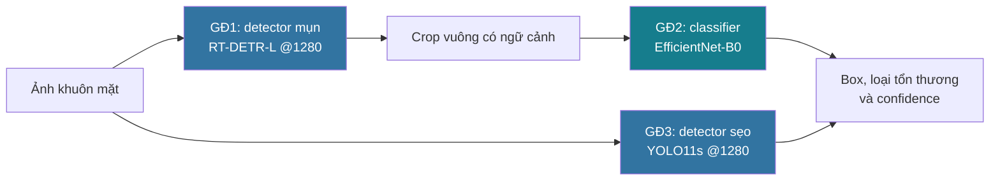
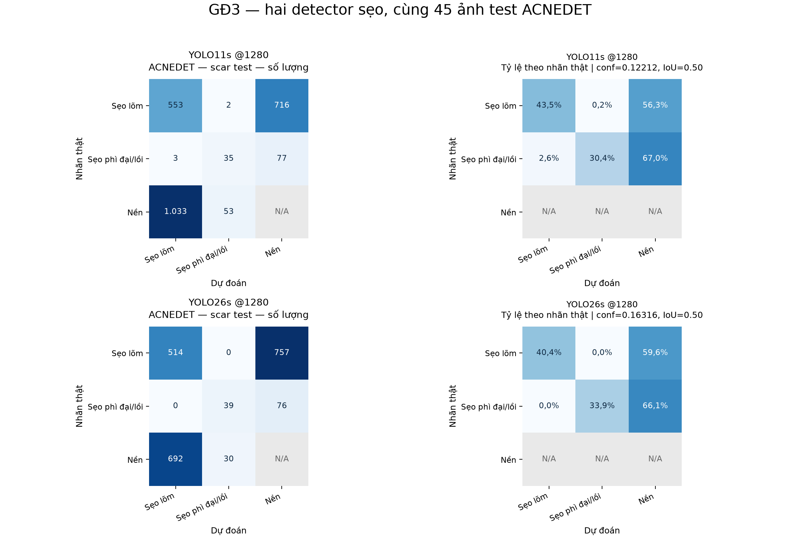

<div align="center">

# BinSpa AI

### Phát hiện mụn, phân loại tổn thương và phát hiện nhóm sẹo trên ảnh khuôn mặt

**Báo cáo thực nghiệm · 3 giai đoạn · Đánh giá test và kiểm tra khả năng tổng quát**

[](requirements-phase1-lock.txt)
[](requirements-phase1-lock.txt)


[Kết quả tổng hợp](reports/publication/README.md) · [Số liệu JSON](reports/publication/metrics.json) · [PDF 20 ma trận](docs/figures/research/confusion_matrices/all_models_confusion_matrices.pdf) · [Chính sách công bố](docs/PRIVACY.md)

</div>

> **Phạm vi:** đây là nguyên mẫu nghiên cứu kỹ thuật, chưa được kiểm định lâm sàng. Accuracy trên crop có nhãn không đại diện cho độ chính xác của toàn bộ hệ thống trên selfie. Các nhãn và ID bệnh nhân của tập thăm dò chưa được xác minh độc lập.

## Tóm tắt

BinSpa AI nghiên cứu một pipeline gồm ba thành phần: **GĐ1** xác định vị trí mụn bằng detector; **GĐ2** phân loại crop thành năm nhóm tổn thương; **GĐ3** phát hiện hai nhóm sẹo. Thực nghiệm gồm 14 checkpoint detector mụn, hai classifier đại diện và hai detector sẹo đại diện được đánh giá trên test. Các run dùng kiến trúc có sẵn; đóng góp của dự án nằm ở chuẩn bị dữ liệu, so sánh thực nghiệm, kiểm tra artifact và phân tích giới hạn khi chuyển miền dữ liệu.

Detector hiện dùng là **RT-DETR-L @1280**, fine-tune trên ACNE04-v2 và phần train ACNEDET. Trên test ACNE04, model đạt mAP50–95 **0,1883**, precision **0,6018**, recall **0,5224**. Classifier **EfficientNet-B0** đạt accuracy **86,60%**, macro-F1 **0,8053** trên 2.537 crop test ACNEDET. Detector sẹo **YOLO11s @1280** đạt mAP50–95 **0,1025** trên 45 ảnh test ACNEDET.

Đánh giá thăm dò trên 1.275 ảnh DetectDataSkin-2 sau sàng lọc cho kết quả thấp hơn: detector mụn đạt F1 **0,1906**, classifier đạt accuracy **22,35%**. Hai nguồn khác nhau về ảnh, quy ước nhãn và phân bố lớp; kết quả này cho thấy cần kiểm tra khả năng tổng quát, không đủ để quy mọi sai khác cho riêng chất lượng model.

## Mục lục

1. [Bài toán và kiến trúc](#1-bài-toán-và-kiến-trúc)
2. [Dữ liệu và cách chia tập](#2-dữ-liệu-và-cách-chia-tập)
3. [Phương pháp và giao thức đánh giá](#3-phương-pháp-và-giao-thức-đánh-giá)
4. [Kết quả trên test gốc](#4-kết-quả-trên-test-gốc)
5. [Đánh giá thăm dò DetectDataSkin-2](#5-đánh-giá-thăm-dò-detectdataskin-2)
6. [Thảo luận và hạn chế](#6-thảo-luận-và-hạn-chế)
7. [Cài đặt và tái lập](#7-cài-đặt-và-tái-lập)
8. [Công bố dữ liệu và quyền sử dụng](#8-công-bố-dữ-liệu-và-quyền-sử-dụng)
9. [Tài liệu tham khảo](#9-tài-liệu-tham-khảo)

## 1. Bài toán và kiến trúc

GĐ1 và GĐ3 nhận ảnh khuôn mặt. GĐ2 nhận crop tổn thương, từ box có nhãn khi benchmark classifier hoặc từ box GĐ1 khi chạy pipeline thực tế. GĐ3 giữ đúng hai lớp nguồn; không suy ra phân loại chi tiết rolling, icepick, boxcar hay keloid.



*Hình 1. Luồng suy luận. Đánh giá từng model và đánh giá pipeline là hai bài toán khác nhau.*

| Thành phần | Nhãn đầu ra | Model hiện dùng | Ngưỡng suy luận mặc định |
| --- | --- | --- | ---: |
| GĐ1 | `acne` | RT-DETR-L @1280, fine-tune | 0,48048 |
| GĐ2 | `closed_comedo`, `open_comedo`, `papule`, `pustule`, `nodule` | EfficientNet-B0 @224 | Top-1 argmax |
| GĐ3 | `atrophic_scar`, `hypertrophic_scar` | YOLO11s @1280 | 0,12212 |

## 2. Dữ liệu và cách chia tập

### 2.1 Các tập dữ liệu

| Nguồn | Vai trò | Train / validation / test | Quy mô test |
| --- | --- | --- | --- |
| ACNE04, nhãn ACNE04-v2 | Detector mụn GĐ1 | 816 / 175 / 176 ảnh | 5.046 box mụn |
| Mirror ACNEDET trên Roboflow | Classifier GĐ2 và detector sẹo GĐ3; phần train dùng thêm cho fine-tune GĐ1 | 190 / 40 / 45 ảnh | 2.537 crop mụn; 1.386 box sẹo |
| DetectDataSkin-2 | Thăm dò với checkpoint và ngưỡng cố định | Không dùng train hoặc chọn ngưỡng | 1.275 ảnh; 18.974 box mụn; 18.846 crop có mapping nhãn hỗ trợ |

ACNE04 và ACNE04-v2 dùng chung nguồn ảnh, không phải hai cohort độc lập. Sau ghép nhãn, cách ly ảnh có lỗi và loại trùng chính xác trước chia tập, bản ACNE04 dùng trong dự án còn **1.167 ảnh, 31.498 tổn thương**. Nguồn ảnh được giới thiệu trong [Wu et al., ICCV 2019](https://openaccess.thecvf.com/content_ICCV_2019/papers/Wu_Joint_Acne_Image_Grading_and_Counting_via_Label_Distribution_Learning_ICCV_2019_paper.pdf); nguồn nhãn v2 được liên kết từ [AcneAI, MICCAI 2024](https://papers.miccai.org/miccai-2024/042-Paper2216.html).

Mirror ACNEDET có **275 ảnh và 31.502 annotation** thuộc nhiều lớp. Dự án chỉ dùng năm lớp mụn cho GĐ2 và hai lớp sẹo cho GĐ3. Các nguồn được chuẩn bị riêng; ảnh không được phân phối lại trong bản công khai.


*Hình 2. Phân bố số tổn thương, kích thước tổn thương và mức độ mụn của bản ACNE04 đã chuẩn bị. Kích thước nốt trung vị khoảng 7,8 pixel ở đầu vào 640; đây là bài toán vật thể nhỏ.*

### 2.2 Đơn vị chia tập và nguy cơ rò rỉ

- ACNE04 được chia theo ảnh sau loại trùng SHA256, seed 42. Không có ID bệnh nhân đã xác minh.
- ACNEDET dùng master split chung cho GĐ2 và GĐ3. Có 50 nhóm suy đoán từ thứ tự ảnh và độ giống ảnh; train/val/test có 34/8/8 nhóm. Đây **không phải xác nhận độc lập theo bệnh nhân**.
- Mọi crop kế thừa split của ảnh gốc. Crop từ cùng ảnh không đi sang split khác.
- Fine-tune GĐ1 dùng 816 ảnh train ACNE04 và 190 ảnh train ACNEDET. Phần test không nằm trong tập train; các tập test đã được xem qua nhiều bước nghiên cứu nên không còn là cohort mới hoàn toàn cho thử nghiệm tương lai.

### 2.3 Phân bố lớp GĐ2

| Lớp | Diễn giải | Train | Validation | Test |
| --- | --- | ---: | ---: | ---: |
| `closed_comedo` | Mụn đầu trắng | 4.127 | 776 | 971 |
| `open_comedo` | Mụn đầu đen | 2.309 | 511 | 473 |
| `papule` | Sẩn | 3.773 | 899 | 867 |
| `pustule` | Mụn mủ | 879 | 196 | 192 |
| `nodule` | Nốt | 143 | 32 | 34 |
| **Tổng** | | **11.231** | **2.414** | **2.537** |

## 3. Phương pháp và giao thức đánh giá

### 3.1 Huấn luyện và lựa chọn

GĐ1 so sánh YOLO26n, YOLO26s, YOLO11s, YOLOv5su, Faster R-CNN và RT-DETR-L, gồm các run kiểm soát đủ lịch, chạy ở 1280 và fine-tune dữ liệu gộp. Ngân sách và lịch train khác nhau giữa các đợt; 14 checkpoint không đại diện cho 14 kiến trúc được tuning hoàn toàn ngang nhau.

GĐ2 so sánh EfficientNet-B0 và ConvNeXt-Tiny pretrained ImageNet. Crop vuông có cạnh `2 × max(w, h)`, tối thiểu 32 pixel, được cắt từ ảnh gốc, đưa về kích thước đầu vào 224 và chuẩn hóa theo checkpoint. Mỗi kiến trúc thử ba cấu hình; cấu hình đại diện chọn bằng validation macro-F1. EfficientNet-B0 được chọn trước bước test đại diện vì validation macro-F1 cao hơn.

GĐ3 thử hai họ YOLO với ba cấu hình mỗi họ: 640, 1280 và 1280 với learning rate thấp hơn. Hai đại diện @1280 gần nhau về validation mAP50–95; quy tắc phá hòa bằng recall lớp sẹo phì đại trên validation chọn YOLO11s.

### 3.2 Chỉ số và ma trận

| Bài toán | Chỉ số | Đơn vị và giao thức |
| --- | --- | --- |
| Detector mụn | mAP50, mAP50–95 | AP từ dự đoán confidence thấp; IoU 0,50:0,05:0,95 |
| Detector mụn | P, R, F1; TP, FP, FN | IoU 0,5; ngưỡng max-F1 chọn trên validation riêng từng model |
| Classifier | Accuracy, macro-F1, balanced accuracy | Top-1 trên crop từ box nhãn; không bao gồm lỗi bỏ sót của detector |
| Detector sẹo | mAP50, mAP50–95 | AP của hai lớp theo evaluator Ultralytics |
| Detector sẹo | Micro P/R/F1 ở ngưỡng cố định | Ghép theo confidence riêng từng lớp, IoU 0,5 |
| Ma trận sẹo đa lớp | Đúng lớp, nhầm lớp, bỏ sót, báo dư | Ghép IoU không xét lớp; cho phép thấy nhầm giữa hai loại sẹo |

Các ma trận thống nhất **hàng = nhãn thật, cột = dự đoán**. Với detector, cột **Nền** là tổn thương bị bỏ sót; hàng **Nền** là dự đoán không ghép được nhãn. Ô nền–nền và tỷ lệ của hàng nền ghi **N/A** vì không xác định được mọi vùng âm tính đúng. Không suy ra specificity từ các ma trận này.

Ma trận GĐ1 được chuyển vị từ số nguyên đã lưu và đối chiếu TP/FP/FN. Ma trận GĐ2 được tính lại từ CSV top-1. Ma trận GĐ3 được chạy lại trên 45 ảnh test ở ngưỡng validation cố định, giữ nguyên checkpoint. Cách ghép ma trận GĐ3 khác cách ghép khi tính micro P/R/F1; không dùng đường chéo ma trận để đối chiếu trực tiếp TP của bảng kia.

### 3.3 Độ bất định và môi trường

Bootstrap ghép cặp 1.000 lần theo **ảnh gốc** được dùng cho so sánh hai classifier và hai detector sẹo. Không lấy từng crop làm mẫu độc lập. Vì nhóm bệnh nhân chưa được xác minh, khoảng tin cậy này vẫn không phải khoảng tin cậy theo bệnh nhân. Mỗi cấu hình chủ yếu dùng một seed; chưa đo đủ biến thiên huấn luyện.

Môi trường thực nghiệm: Windows, Python 3.12, PyTorch, torchvision, timm, Ultralytics; GPU RTX 5050 Laptop 8 GB. Phiên bản đã cài được lưu trong [file lock](requirements-phase1-lock.txt). Các lệnh tải pretrained cần kết nối mạng. Thời gian suy luận phụ thuộc thiết bị, batch và bước tiền xử lý.

## 4. Kết quả trên test gốc

### 4.1 GĐ1 — phát hiện mụn

*Bảng 1. Các đại diện và biến thể @1280 trên cùng 176 ảnh test ACNE04. P/R/F1 dùng ngưỡng validation riêng; “fine-tune” dùng thêm phần train ACNEDET. Số liệu từ artifact đánh giá của đúng checkpoint, không lấy test metadata cũ của model trước fine-tune.*

<!-- PHASE1_TABLE -->

| Model | mAP50 | mAP50–95 | Precision | Recall | F1 |
| --- | ---: | ---: | ---: | ---: | ---: |
| Faster R-CNN @640 | 0.3830 | 0.1309 | 0.4959 | 0.4094 | 0.4485 |
| Faster R-CNN @640, full50 | 0.3880 | 0.1298 | 0.4984 | 0.4100 | 0.4499 |
| RT-DETR-L @640 | 0.4220 | 0.1432 | 0.5512 | 0.4364 | 0.4871 |
| RT-DETR-L @640, full100 | 0.4201 | 0.1407 | 0.5397 | 0.4388 | 0.4840 |
| YOLO11s @640 | 0.4089 | 0.1454 | 0.5280 | 0.3973 | 0.4535 |
| YOLO11s @640, full100 | 0.4115 | 0.1433 | 0.5471 | 0.3983 | 0.4610 |
| YOLO26n @640 | 0.3514 | 0.1188 | 0.4997 | 0.3603 | 0.4187 |
| YOLO26s @640 | 0.4236 | 0.1483 | 0.5344 | 0.4275 | 0.4750 |
| YOLOv5su @640 | 0.4015 | 0.1391 | 0.5251 | 0.3997 | 0.4539 |
| RT-DETR-L @1280 | 0.5282 | 0.1912 | 0.6070 | 0.5115 | 0.5552 |
| YOLO11s @1280 | 0.5089 | 0.1874 | 0.5974 | 0.4861 | 0.5361 |
| YOLO26s @1280 | 0.5070 | 0.1941 | 0.5943 | 0.4804 | 0.5313 |
| RT-DETR-L @1280, fine-tune **(đang dùng)** | 0.5245 | 0.1883 | 0.6018 | 0.5224 | 0.5593 |
| YOLO26s @1280, fine-tune | 0.4994 | 0.1839 | 0.5963 | 0.4719 | 0.5268 |

<!-- /PHASE1_TABLE -->


*Hình 3. mAP50–95 và recall của 14 checkpoint. Màu xanh ngọc đánh dấu RT-DETR-L fine-tune hiện dùng. Run đủ lịch và fine-tune là các biến thể thực nghiệm; biểu đồ không chứng minh chênh lệch có ý nghĩa thống kê.*


*Hình 4. Ma trận số lượng của năm detector @1280, cùng nhãn test ACNE04. RT-DETR-L fine-tune có TP = 2.636, FP = 1.744, FN = 2.410: vẫn bỏ sót 47,8% tổn thương có nhãn ở ngưỡng hiện dùng. [Xem nhóm @640](docs/figures/research/confusion_matrices/phase1_640_comparison.png).* 

### 4.2 GĐ2 — phân loại loại mụn

*Bảng 2. Top-1 trên 2.537 crop từ 45 ảnh test ACNEDET; CI macro-F1 là bootstrap theo ảnh.*

<!-- PHASE2_TABLE -->

| Model | Accuracy | Macro-F1 [CI 95%] | Balanced accuracy |
| --- | ---: | --- | ---: |
| EfficientNet-B0 **(đang dùng)** | 86.60% | 0.8053 [0.7571; 0.8434] | 0.8064 |
| ConvNeXt-Tiny | 86.83% | 0.8322 [0.8043; 0.8622] | 0.8311 |

<!-- /PHASE2_TABLE -->

Chênh lệch macro-F1 ConvNeXt-Tiny trừ EfficientNet-B0 là **+0,0269**, CI 95% **[−0,0123; +0,0741]**. Chưa đủ bằng chứng cho khác biệt có ý nghĩa thống kê. Model hiện dùng giữ lựa chọn từ validation, không đổi chỉ vì thứ hạng test.


*Hình 5. Trái: số crop. Phải: tỷ lệ theo hàng nhãn thật; đường chéo là recall từng lớp. EfficientNet-B0 nhầm 75 crop đầu trắng thành sẩn và 36 crop mủ thành sẩn.*


*Hình 6. F1 và support test của từng lớp. Lớp nốt chỉ có 34 mẫu; chỉ số của lớp này dễ dao động. Accuracy 86,60% không bao gồm các nốt GĐ1 bỏ sót.*

### 4.3 GĐ3 — phát hiện nhóm sẹo

*Bảng 3. AP trên 45 ảnh test, 1.271 sẹo lõm và 115 sẹo phì đại. Micro P/R/F1 được tính lại từ TP/FP/FN ở ngưỡng validation cố định; không dùng P/R tại điểm F1 tối ưu trên test của báo cáo Ultralytics cũ.*

<!-- PHASE3_TABLE -->

| Model | mAP50 | mAP50–95 [CI 95%] | Micro P | Micro R | Micro F1 | Conf |
| --- | ---: | --- | ---: | ---: | ---: | ---: |
| YOLO11s @1280 **(đang dùng)** | 0.3145 | 0.1025 [0.0757; 0.1298] | 0.3508 | 0.4250 | 0.3843 | 0.12212 |
| YOLO26s @1280 | 0.3507 | 0.1190 [0.0889; 0.1500] | 0.4337 | 0.3990 | 0.4156 | 0.16316 |

<!-- /PHASE3_TABLE -->

Chênh lệch mAP50–95 YOLO26s trừ YOLO11s có CI 95% **[−0,0075; +0,0400]**. Với tập test này, chưa xác nhận được khác biệt. YOLO11s giữ vai trò model đã chọn từ validation.



*Hình 7. Ma trận sẹo ở ngưỡng cố định, ghép IoU không xét lớp. Ngoài nhầm giữa hai loại sẹo, lỗi lớn là bỏ sót và báo dư. Số đường chéo có thể khác TP trong Bảng 3 do phương pháp ghép khác nhau.*

## 5. Đánh giá thăm dò DetectDataSkin-2

### 5.1 Sàng lọc và mapping

Archive có **3.462 ảnh, 93.717 annotation**; tên split có sẵn không được dùng để tuyên bố một test mới độc lập. Qua kiểm tra trùng chính xác, nguồn tên ảnh, ảnh gần trùng và dấu hiệu chồng với dữ liệu đã dùng, còn **1.275 ảnh** trong tập thăm dò. Các trường hợp nghi chồng lặp được cách ly. Phương pháp này chưa loại trừ mọi biến thể ảnh hoặc cùng một người ở hai nguồn.

Mapping GĐ2 tạm thời: `Whitehead → closed_comedo`, `Blackhead → open_comedo`, `Papule → papule`, `Pustule → pustule`, `Nodule/Nodules → nodule`. `Cysts` không đưa vào classifier năm lớp. `Bekas Jerawat` không đủ phân biệt hai loại sẹo nên **không đánh giá GĐ3** trên nguồn này.

Checkpoint, confidence và cách tiền xử lý được giữ cố định trước suy luận. Không train hay chọn lại ngưỡng trên tập thăm dò. Nhãn nguồn chưa được chuyên gia kiểm tra; 108 ảnh không có nhãn mụn không được coi là ảnh da sạch đã xác minh.

### 5.2 Kết quả

| Thành phần | Mẫu đánh giá | Chỉ số chính |
| --- | --- | --- |
| GĐ1 RT-DETR-L fine-tune | 1.275 ảnh, 18.974 nhãn mụn | P = 0,2243; R = 0,1657; F1 = 0,1906; mAP50–95 = 0,0180 |
| GĐ2 EfficientNet-B0, crop từ box nhãn | 18.846 crop hỗ trợ mapping | Accuracy = 22,35%; macro-F1 = 0,2027 |
| Pipeline GĐ1 → GĐ2 | Ghép đúng lớp và IoU ≥ 0,5 | Micro-F1 = 0,0508 |


*Hình 8. Detector bỏ sót nhiều nhãn nguồn; classifier nhận đúng khoảng 3,8% crop lớp mủ và 4,1% crop lớp nốt. Các tỷ lệ này phụ thuộc mapping nhãn tạm thời và khác biệt nguồn ảnh; không phải kết quả xác nhận lâm sàng.*


*Hình 9. Confidence top-1 trung bình 72,59% trong khi accuracy 22,35%; ECE 10 bin = 0,5024. Confidence cao không đủ để tin dự đoán. Đây là chẩn đoán trên nhãn được cung cấp, chưa hiệu chỉnh và chưa kiểm định theo bệnh nhân.*

## 6. Thảo luận và hạn chế

Kết quả test gốc cho thấy hệ thống có thể học đặc trưng tổn thương trong miền ảnh đã dùng. Tuy nhiên detector mụn vẫn bỏ sót gần một nửa nhãn ACNE04, detector sẹo có AP thấp, và classifier suy giảm đáng kể trên bộ thăm dò. Bằng chứng hiện tại **chưa đủ để khẳng định hệ thống đáng tin cậy trên selfie thực tế**.

| Hạn chế | Ảnh hưởng tới diễn giải | Thực nghiệm cần bổ sung |
| --- | --- | --- |
| Thiếu ID bệnh nhân đã xác minh | Chưa bảo đảm người ở test khác người ở train | Cohort mới, chia theo người trước tạo crop |
| Nhãn selfie chưa được thẩm định | Sai khác ontology có thể bị tính như lỗi model | Review pilot và thống nhất hướng dẫn gán nhãn |
| Chỉ 45 ảnh test ACNEDET; mất cân bằng lớp | CI rộng; lớp hiếm thiếu ổn định | Tăng số người và số mẫu lớp hiếm |
| Một seed cho phần lớn cấu hình | Chưa đo độ nhạy với khởi tạo | Nhiều seed, báo trung bình và độ lệch |
| Test đã được xem trong tiến trình nghiên cứu | Kết quả tiếp theo trên cùng test là thăm dò | Khóa một test mới trước cải tiến |
| Benchmark classifier dùng crop nhãn | Chưa bao gồm lỗi bỏ sót và sai box GĐ1 | Đánh giá pipeline đúng lớp, đúng vị trí |
| Confidence chưa được hiệu chỉnh trên miền đích | Có thể dự đoán sai với confidence cao | Hiệu chỉnh trên validation riêng, chấm trên test mới |

Ưu tiên tiếp theo là pilot selfie có quyền sử dụng, nhãn được kiểm tra, ID người rõ ràng và một test mới được khóa. Việc hạ confidence chỉ thay đổi đánh đổi bỏ sót/báo dư; không thay thế đánh giá chất lượng.

## 7. Cài đặt và tái lập

### 7.1 Môi trường

```powershell
python -m venv venv
.\venv\Scripts\python.exe -m pip install torch torchvision --index-url https://download.pytorch.org/whl/cu128
.\venv\Scripts\python.exe -m pip install -r requirements-phase1.txt
.\venv\Scripts\python.exe -m pip check
```

Ví dụ trên dùng build CUDA tương ứng môi trường thực nghiệm; thiết bị khác cần chọn build PyTorch phù hợp. File `requirements-phase1.txt` hiện bao gồm cả timm cho GĐ2. [File lock](requirements-phase1-lock.txt) ghi phiên bản đã cài; không bảo đảm tái lập bitwise trên mọi thiết bị.

### 7.2 Đầu vào được chuẩn bị riêng

Ảnh, annotation, manifest từng ảnh, checkpoint và metadata suy luận không kèm trong bản công khai. Người chạy cần quyền truy cập nguồn và phải chuẩn bị các artifact đúng với script. Chỉ các hình và số liệu tổng hợp có thể xem ngay sau khi clone.

```text
BinSpa_AI/
├── scripts/phase1/       # chuẩn bị, train, chấm detector mụn
├── scripts/phase2/       # master split, crop, train/chấm classifier
├── scripts/phase3/       # chuẩn bị, train/chấm detector sẹo
├── docs/figures/         # chỉ biểu đồ và ma trận tổng hợp
├── reports/publication/  # số liệu JSON, manifest artifact công khai
├── datasets/             # dữ liệu có quyền truy cập, lưu riêng
├── models/               # checkpoint + metadata tương ứng, lưu riêng
└── test_img/             # ảnh tự kiểm tra, lưu riêng
```

Ví dụ các bước sau khi đã chuẩn bị dữ liệu riêng:

```powershell
# GĐ1: hướng dẫn đầy đủ ở scripts/phase1/README.md
.\venv\Scripts\python.exe scripts\phase1\split_phase1.py
.\venv\Scripts\python.exe scripts\phase1\test_phase1.py

# GĐ2: master split chung cho GĐ2 và GĐ3, tạo crop rồi train.
.\venv\Scripts\python.exe scripts\phase2\audit_and_split.py
.\venv\Scripts\python.exe scripts\phase2\make_crops.py
.\venv\Scripts\python.exe scripts\phase2\train_classifier.py --model efficientnet_b0 --config cfg_a

# GĐ3: chuẩn bị nhãn sẹo theo cùng master split.
.\venv\Scripts\python.exe scripts\phase3\build_scar_dataset.py
.\venv\Scripts\python.exe scripts\phase3\train_scar.py --model yolo11s --config c1280
```

Các script train và chọn model là workflow nghiên cứu, có thể tạo hoặc thay metadata/checkpoint trong thư mục riêng. Để chấm lại đúng các kết quả đã công bố, cần cùng manifest và checkpoint hash; train mới sẽ tạo một thực nghiệm mới.

```powershell
# Suy luận: cần models/ và metadata tương ứng, dùng ảnh của bạn.
.\venv\Scripts\python.exe scripts\phase1\predict_acne.py --source test_img\selfie.jpg
.\venv\Scripts\python.exe scripts\phase2\predict_acne_type.py --face test_img\selfie.jpg --out reports\local\acne_types.json
.\venv\Scripts\python.exe scripts\phase3\predict_scar.py --source test_img\selfie.jpg

# Chỉ khi có các báo cáo đánh giá riêng: vẽ và xuất bản tổng hợp.
.\venv\Scripts\python.exe scripts\plot_model_confusion_matrices.py
.\venv\Scripts\python.exe scripts\prepare_publication.py

# Kiểm tra tập file công khai trước commit/push.
.\venv\Scripts\python.exe scripts\check_publication.py
```

`artifact_manifest.json` chứa SHA256 các hình và bảng tổng hợp. `confusion_matrices.json` lưu ma trận số nguyên, hướng trục, support và checkpoint hash. Các record ảnh và tọa độ box được giữ riêng, vì vậy bản công khai không cung cấp khả năng tái lập độc lập đầy đủ chỉ bằng một lệnh.

## 8. Công bố dữ liệu và quyền sử dụng

Bản công khai gồm mã nguồn, yêu cầu môi trường, báo cáo tổng hợp, biểu đồ và 20 ma trận: 18 checkpoint trên test gốc và hai kết quả của checkpoint hiện dùng trên DetectDataSkin-2. Ảnh khuôn mặt, crop, nhãn từng ảnh, dự đoán từng ảnh, tài liệu cá nhân, file ZIP dữ liệu, venv và checkpoint không nằm trong bản công bố hiện tại.

`.gitignore` bảo vệ việc thêm file mới, **không xóa dữ liệu trong lịch sử Git**. Các commit hoặc nhánh cũ có thể vẫn chứa artifact trước khi dọn. Xem [phạm vi bảo vệ và xử lý lịch sử](docs/PRIVACY.md).

Nguồn [ACNE04 của tác giả](https://github.com/xpwu95/LDL) nêu phạm vi sử dụng học thuật và yêu cầu liên hệ cho mục đích khác. Không suy ra quyền thương mại từ việc tải được dataset hoặc từ license của một mirror. Với ACNEDET và DetectDataSkin-2, cần xác minh quyền của nguồn gốc, quyền phân phối ảnh và sự đồng ý phù hợp trước sử dụng ngoài phạm vi nghiên cứu.

## 9. Tài liệu tham khảo

1. Wu et al. **Joint Acne Image Grading and Counting via Label Distribution Learning.** ICCV 2019. [Bài báo](https://openaccess.thecvf.com/content_ICCV_2019/papers/Wu_Joint_Acne_Image_Grading_and_Counting_via_Label_Distribution_Learning_ICCV_2019_paper.pdf), [nguồn ACNE04](https://github.com/xpwu95/LDL).
2. Gazeau et al. **AcneAI: A New Acne Severity Assessment Method Using Digital Images and Deep Learning.** MICCAI 2024. [Trang hội nghị](https://papers.miccai.org/miccai-2024/042-Paper2216.html), [nhãn ACNE04-v2](https://github.com/AIpourlapeau/acne04v2).
3. [Ultralytics](https://github.com/ultralytics/ultralytics), [PyTorch / torchvision](https://github.com/pytorch/vision), [timm](https://github.com/huggingface/pytorch-image-models): triển khai model và công cụ thực nghiệm; phiên bản dùng trong dự án nằm ở file lock.

Các kết quả trong README là thực nghiệm của **BinSpa AI** với split và evaluator riêng. Không phải kết quả của các bài báo nguồn, không phải so sánh trực tiếp với benchmark khác, và chưa được phản biện hoặc kiểm định lâm sàng.
