<div align="center">

# BinSpa AI — Phát hiện mụn trên ảnh khuôn mặt

**Giai đoạn 1: so sánh có kiểm soát 6 detector trên ACNE04-v2**


</div>

> [!IMPORTANT]
> Kết quả phân tích hình ảnh chỉ mang tính **tham khảo chăm sóc da**, không phải chẩn đoán y khoa. Dataset ACNE04 có giấy phép **chỉ dùng cho học thuật** — xem [§10](#10-giấy-phép-dữ-liệu-và-đạo-đức).

---

## Tóm tắt

Bin Spa cần một mô-đun AI phát hiện vị trí nốt mụn trên ảnh khuôn mặt do khách hàng chụp và gửi lên, làm đầu vào cho hồ sơ da (Skin Profile) và gợi ý dịch vụ. Chúng tôi xây dựng một bộ dữ liệu sạch từ **ACNE04-v2** (1.167 ảnh, 31.498 nốt mụn sau khi loại trùng và cách ly nhãn lỗi), chia cố định train/val/test = **816/175/176** (seed 42), rồi so sánh **6 kiến trúc** — YOLO26n, YOLO26s, YOLO11s, YOLOv5s, Faster R-CNN R50-FPN và RT-DETR-L — dưới cùng một giao thức: ngân sách tuning bằng nhau, lựa chọn chỉ dựa trên validation, một evaluator chung cho mọi framework, khoảng tin cậy bootstrap ghép cặp và đo latency có kiểm soát.

**Kết quả chính.** Trên tập test, **YOLO26s** đạt mAP50 **0,424** và mAP50-95 **0,148** (CI 95%: 0,134–0,165), Recall 0,428, F1 0,475 với **10,8 ms/ảnh** và **19 MB**. RT-DETR-L và YOLO11s không khác biệt có ý nghĩa thống kê về mAP50-95; YOLOv5s, Faster R-CNN và YOLO26n kém hơn có ý nghĩa. RT-DETR-L có Recall/F1 nhỉnh hơn (không có ý nghĩa thống kê) nhưng chậm hơn ~2,6×, nặng hơn ~3× và sót nhiều hơn ở ảnh mụn dày đặc do giới hạn 300 truy vấn. Ở 640, **YOLO26s** được chọn. Hạn chế lớn nhất chung cho mọi model là nốt mụn rất nhỏ (trung vị **7,8 px** ở đầu vào 640).

**Thử nghiệm độ phân giải ([§5.8](#58-thử-nghiệm-độ-phân-giải-1280-và-model-cuối)).** Train lại 3 model hòa điểm ở **imgsz 1280** làm tăng mọi chỉ số có ý nghĩa thống kê. Theo cùng quy tắc chọn, **RT-DETR-L @1280** là model triển khai cuối cùng: test Recall **0,511**, Precision 0,607, F1 0,555, mAP50-95 0,191, khoảng 78 ms/ảnh. Recall và F1 hơn YOLO26s @1280 có ý nghĩa thống kê. So với YOLO26s @640: Recall +8,5 điểm, Precision +7,3 điểm.

## Mục lục

1. [Bối cảnh và kiến trúc hệ thống](#1-bối-cảnh-và-kiến-trúc-hệ-thống)
2. [Dữ liệu](#2-dữ-liệu)
3. [Phương pháp](#3-phương-pháp)
4. [Thiết lập thực nghiệm](#4-thiết-lập-thực-nghiệm)
5. [Kết quả](#5-kết-quả)
6. [Thảo luận](#6-thảo-luận)
7. [Hạn chế](#7-hạn-chế)
8. [Hướng phát triển](#8-hướng-phát-triển)
9. [Tái lập kết quả](#9-tái-lập-kết-quả)
10. [Giấy phép dữ liệu và đạo đức](#10-giấy-phép-dữ-liệu-và-đạo-đức)
11. [Tài liệu tham khảo](#11-tài-liệu-tham-khảo)

---

## 1. Bối cảnh và kiến trúc hệ thống

Hệ thống phân tích da của Bin Spa gồm 3 giai đoạn độc lập, hoàn thành từng giai đoạn rồi mới ghép. Repository này hiện chứa **Giai đoạn 1 – phát hiện mụn**.

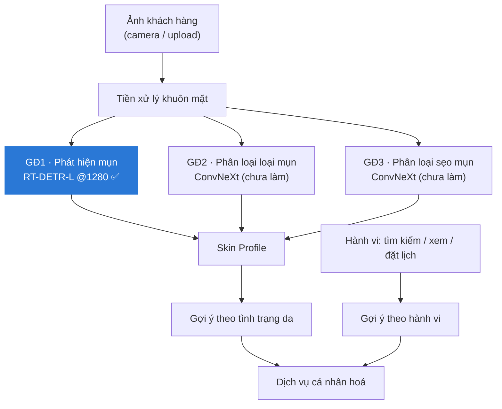

**Yêu cầu của bài toán.** Ảnh được chụp rồi gửi lên (không cần real-time 30 FPS), nên ưu tiên **chất lượng phát hiện**; latency chỉ cần thực tế cho một backend Flask phục vụ nhiều người dùng.

## 2. Dữ liệu

### 2.1 Nguồn

- **ACNE04** (Wu et al., ICCV 2019): 1.457 ảnh khuôn mặt, chấm mức độ mụn theo thang Hayashi 4 mức.
- **ACNE04-v2** (Gazeau et al., MICCAI 2024): gán nhãn lại bởi chuyên gia trên 1.204 ảnh con của ACNE04, **32.443** nốt mụn dạng tâm + bán kính.

Chỉ dùng nhãn v2; không coi ACNE04 và ACNE04-v2 là hai bộ ảnh độc lập.

### 2.2 Làm sạch và chia dữ liệu

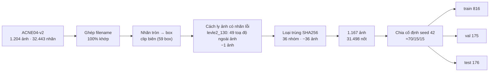

- Box = hình vuông ngoại tiếp vòng tròn nhãn; box vượt biên được cắt lại và ghi log.
- Ảnh có nhãn không hợp lệ bị **cách ly toàn bộ** thay vì đoán lại toạ độ, để tránh giám sát thiếu.
- Ảnh trùng nội dung (SHA256) bị loại **trước** khi chia, giữ tên file đầu tiên theo thứ tự từ điển; không gộp nhãn xung đột.
- `manifest.json` lưu SHA256 của mọi ảnh và nhãn. Mọi script train/eval kiểm tra lại trước khi chạy và từ chối nếu dữ liệu thay đổi.
- Không có ID bệnh nhân, nên split theo ảnh, chưa đảm bảo độc lập theo người.

### 2.3 Thống kê

| Split | Ảnh | Nốt mụn | Level 0 | Level 1 | Level 2 | Level 3 |
|---|---:|---:|---:|---:|---:|---:|
| train | 816 | 21.193 | 327 | 400 | 80 | 9 |
| val | 175 | 5.259 | 65 | 82 | 25 | 3 |
| test | 176 | 5.046 | 68 | 78 | 20 | 10 |
| **tổng** | **1.167** | **31.498** | 460 | 560 | 125 | 22 |


*Hình 1. (a) Phân bố số nốt/ảnh tương tự giữa các split; 1 ảnh test có 434 nốt. (b) Kích thước nốt ở đầu vào 640 px: trung vị 7,8 px, p5 = 3,7 px, p95 = 18,7 px — vật thể rất nhỏ. (c) Mức độ mụn nặng (level 3) rất hiếm và phân bố lệch: train chỉ có 9 ảnh trong khi test có 10.*

## 3. Phương pháp

### 3.1 Các model

| Model | Họ | Pretrained | Tham số | GFLOPs @640 | Ghi chú |
|---|---|---|---:|---:|---|
| YOLO26n | YOLO (một giai đoạn) | COCO | 2,4 M | 5,3 | NMS-free head |
| YOLO26s | YOLO (một giai đoạn) | COCO | 9,5 M | 20,8 | |
| YOLO11s | YOLO (một giai đoạn) | COCO | 9,4 M | 21,4 | |
| YOLOv5s | YOLO (một giai đoạn) | COCO | 9,1 M | 23,8 | biến thể `yolov5su` (head anchor-free) |
| Faster R-CNN R50-FPN | hai giai đoạn | COCO_V1 | 41,4 M | 166,1 | anchor nhỏ 8–128 px |
| RT-DETR-L | transformer (DETR) | COCO | 32,0 M | 105,3 | 300 truy vấn → tối đa 300 box/ảnh |

### 3.2 Giao thức huấn luyện và lựa chọn

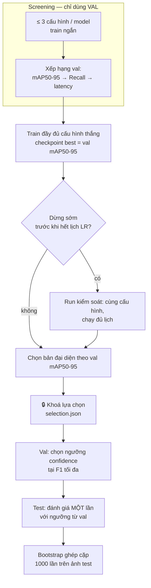

- **Không dùng test để chọn** bất cứ thứ gì: cấu hình, checkpoint, ngưỡng confidence đều chọn trên val.
- **Ngân sách tuning**: mỗi model mới tối đa 3 cấu hình screening. YOLO26n/26s/11s được train trước đó với một cấu hình duy nhất (AdamW, lr 1e-3) và không được train lại.
- **Dừng sớm**: YOLO11s (77/100 epoch), Faster R-CNN (29/50) và RT-DETR-L (78/100) dừng do patience trước khi learning rate giảm hết. Mỗi model có một run kiểm soát chạy đủ lịch; bản có val mAP50-95 cao hơn được dùng làm đại diện.

### 3.3 Đánh giá thống nhất giữa các framework

Ultralytics và torchvision tính metric theo cách khác nhau, vì vậy mọi model được quy về **dự đoán theo pixel ảnh gốc** và chấm bằng cùng một evaluator ([`evaluate_detector_common.py`](scripts/phase1/evaluate_detector_common.py)):

| Chỉ số | Định nghĩa |
|---|---|
| mAP50, mAP50-95 | `ap_per_class` + ghép tham lam theo IoU của Ultralytics; IoU 0,50:0,05:0,95; dự đoán conf ≥ 0,001, tối đa 500 box |
| Precision, Recall, F1, TP, FP, FN | tại ngưỡng confidence cho **F1 cao nhất trên val**, áp nguyên lên test; ghép 1–1 với IoU ≥ 0,5 |
| Khoảng tin cậy 95% | bootstrap percentile ghép cặp, 1000 lần lấy mẫu lại 176 ảnh test, cùng mẫu cho mọi model |
| Latency | ảnh gốc (đã giải mã) → box cuối, batch 1, FP32; 30 ảnh test × 5 vòng xen kẽ; median. GPU forward đo riêng bằng CUDA event |

Kiểm tra chéo: evaluator chung cho YOLO26s val mAP50-95 = 0,1557 so với 0,1574 khi Ultralytics tự chấm. Các model YOLO cũ trên test lệch ≤ 0,0015.

## 4. Thiết lập thực nghiệm

**Phần cứng và phần mềm.** NVIDIA GeForce RTX 5050 Laptop 8 GB · Intel i7-13650HX · 25 GB RAM · Windows 11 · Python 3.12.7 · PyTorch 2.11.0 + CUDA 12.8 · torchvision 0.26.0 · Ultralytics 8.4.173. AMP bật khi train, seed 42, chế độ deterministic.

| | YOLO26n/26s/11s | YOLOv5s | Faster R-CNN | RT-DETR-L |
|---|---|---|---|---|
| Ảnh đầu vào | 640 | 640 | cạnh dài 640 | 640 |
| Batch | 8 | 8 | 4 ¹ | 8 |
| Optimizer | AdamW 1e-3 | **SGD 1e-2** | **SGD 1e-2**, cosine | **AdamW 2e-4** |
| Weight decay | 5e-4 | 5e-4 | 1e-4 | 1e-4 |
| Epoch tối đa / patience | 100 / 20 | 100 / 20 | 50 / 10 | 100 / 20 |
| Augmentation | mosaic, scale, HSV, flip | như YOLO | crop 0,6–1, flip, độ sáng | như YOLO |
| Cấu hình đã thử | 1 | 3 | 3 (anchor, LR) | 3 (LR, mosaic) |
| Best epoch (bản đại diện) | 89 / 89 / 90 | 82 | 19 | 58 |
| VRAM khi train | — | 2,8 GB | 4,6 GB | 6,9 GB |

¹ Faster R-CNN dùng batch 8 sẽ cần ~8–9 GB VRAM. Chi tiết từng cấu hình và kết quả screening: [reports/phase1_additional_models/README.md](reports/phase1_additional_models/README.md).

## 5. Kết quả

### 5.1 Kết quả chính trên tập test

*Bảng 1. Test (176 ảnh, 5.046 nốt). P/R/F1/TP/FP/FN ở ngưỡng chọn trên val, IoU 0,5. **Đậm** = tốt nhất cột.*

| Model | Precision | Recall | F1 | mAP50 | mAP50-95 [CI 95%] | ms/ảnh | MB | TP | FP | FN |
|---|---:|---:|---:|---:|---|---:|---:|---:|---:|---:|
| **YOLO26s** | 0,534 | 0,428 | 0,475 | **0,424** | **0,148** [0,134–0,165] | 10,8 | 19,4 | 2.157 | 1.879 | 2.889 |
| YOLO11s | 0,547 | 0,398 | 0,461 | 0,412 | 0,143 [0,130–0,158] | 9,2 | 18,3 | 2.010 | **1.664** | 3.036 |
| RT-DETR-L | **0,551** | **0,436** | **0,487** | 0,422 | 0,143 [0,126–0,161] | 28,4 | 63,2 | **2.202** | 1.793 | **2.844** |
| YOLOv5s | 0,525 | 0,400 | 0,454 | 0,402 | 0,139 [0,126–0,153] | **8,3** | 17,7 | 2.017 | 1.824 | 3.029 |
| Faster R-CNN | 0,498 | 0,410 | 0,450 | 0,388 | 0,130 [0,117–0,145] | 54,0 | 79,1 | 2.069 | 2.082 | 2.977 |
| YOLO26n | 0,500 | 0,360 | 0,419 | 0,351 | 0,119 [0,105–0,133] | 10,3 | **5,1** | 1.818 | 1.820 | 3.228 |

<table>
<tr>
<td>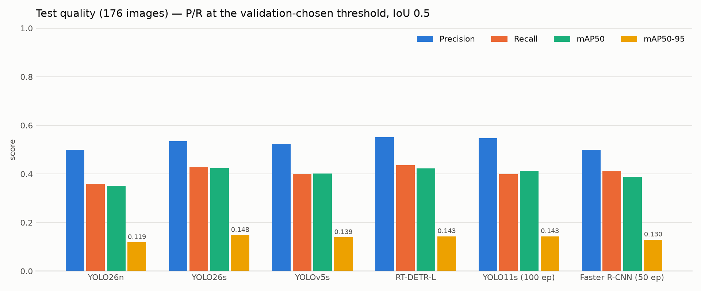</td>
<td>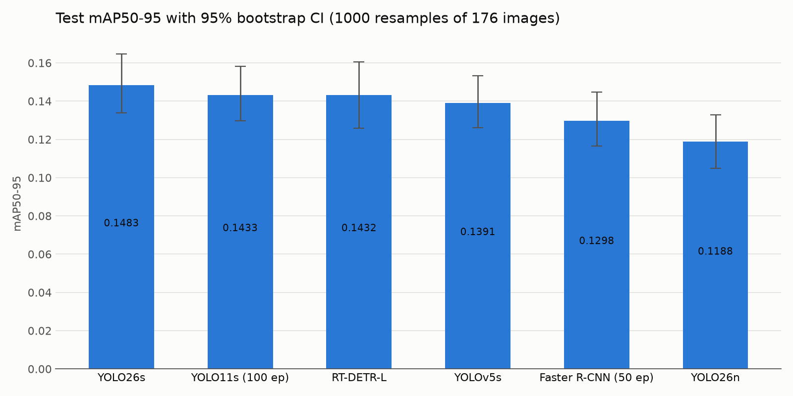</td>
</tr>
<tr>
<td align="center"><i>Hình 2. Precision, Recall, mAP50, mAP50-95 trên test.</i></td>
<td align="center"><i>Hình 3. mAP50-95 kèm khoảng tin cậy bootstrap 95%.</i></td>
</tr>
</table>

### 5.2 Chênh lệch có ý nghĩa thống kê không?

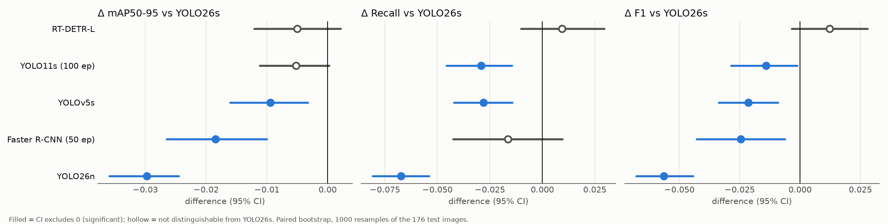

*Hình 4. Chênh lệch so với YOLO26s (bootstrap ghép cặp, CI 95%). Chấm đặc = có ý nghĩa thống kê.*

- **RT-DETR-L** không khác YOLO26s ở bất kỳ chỉ số nào: Δ mAP50-95 = −0,005 [−0,012; +0,002], Δ Recall = +0,009 [−0,010; +0,029].
- **YOLO11s** ngang về mAP50-95 nhưng Recall thấp hơn rõ: −0,029 [−0,046; −0,015].
- **YOLOv5s, Faster R-CNN, YOLO26n** kém hơn có ý nghĩa về mAP50-95 và F1.
- Với 176 ảnh test, CI của mAP50-95 rộng khoảng ±0,015, nên chênh lệch dưới ~0,005 không thể phân biệt.

### 5.3 Validation và quy tắc lựa chọn

| Model | Precision | Recall | F1 | mAP50 | mAP50-95 |
|---|---:|---:|---:|---:|---:|
| YOLO11s | 0,539 | 0,409 | 0,465 | 0,422 | **0,1566** |
| YOLO26s | 0,535 | 0,429 | 0,476 | **0,434** | 0,1557 |
| RT-DETR-L | 0,538 | **0,455** | **0,493** | 0,430 | 0,1557 |
| YOLOv5s | 0,543 | 0,411 | 0,468 | 0,418 | 0,1496 |
| Faster R-CNN | 0,511 | 0,421 | 0,461 | 0,406 | 0,1405 |
| YOLO26n | 0,493 | 0,370 | 0,423 | 0,361 | 0,1308 |

Ba model đầu cách nhau dưới 0,001 mAP50-95 trên val, tức là hoà. Theo quy tắc, Recall phân định và RT-DETR-L đứng đầu. Lợi thế Recall này **không được xác nhận trên test** (§5.2); quyết định triển khai cân nhắc thêm nhóm tiêu chí triển khai (§6).

### 5.4 Ảnh hưởng của mật độ mụn

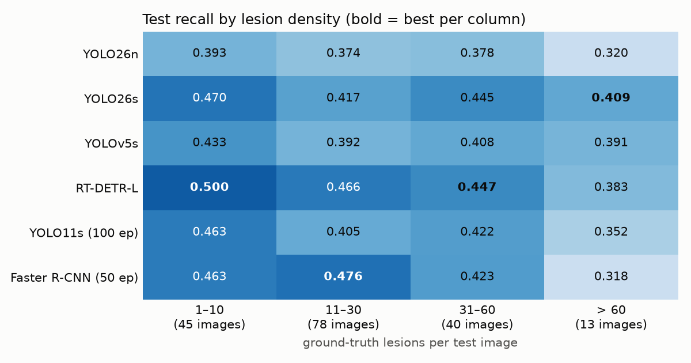

*Hình 5. Recall trên test theo số nốt mụn/ảnh.* RT-DETR-L tốt nhất ở ảnh ít và vừa mụn, nhưng giảm ở ảnh > 60 nốt. Trên ảnh dày nhất (434 nốt), số nốt phát hiện đúng là: YOLO26s **118**, YOLOv5s 116, YOLO11s 111, YOLO26n 90, RT-DETR-L 81 (bị chặn bởi 300 truy vấn), Faster R-CNN 68.

### 5.5 Triển khai: tốc độ và kích thước

<table>
<tr>
<td>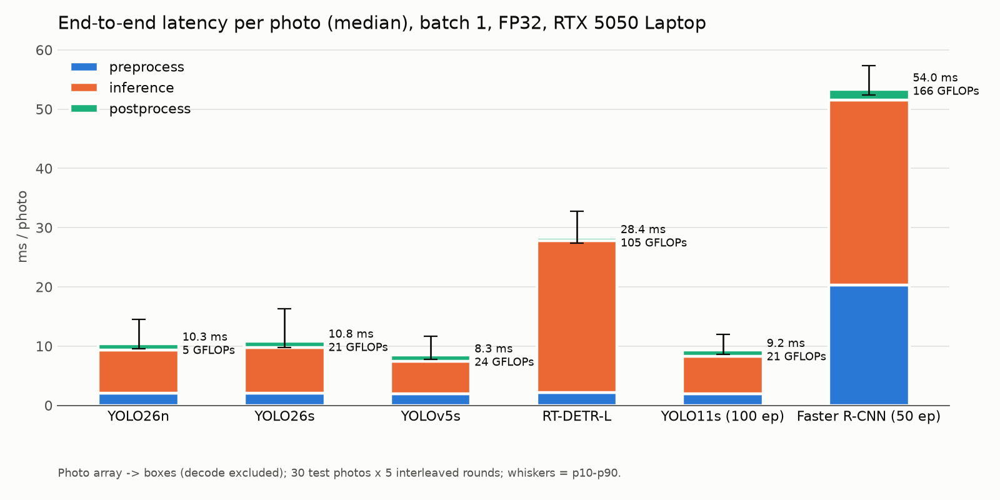</td>
<td>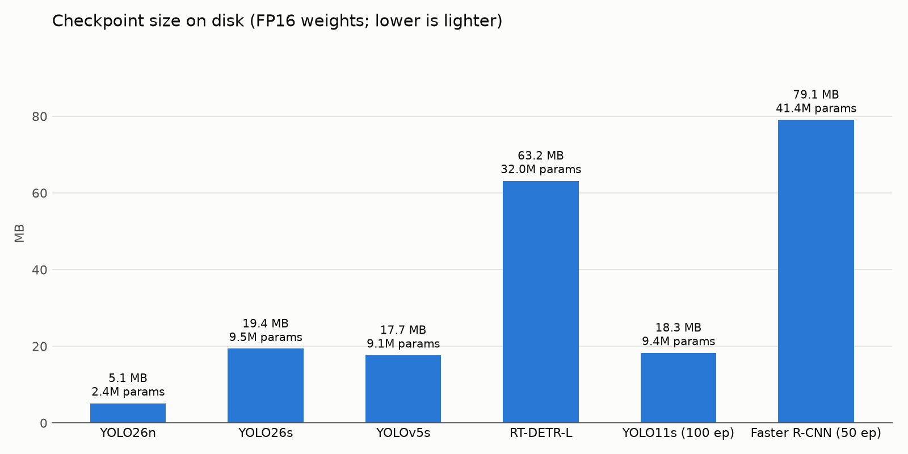</td>
</tr>
<tr>
<td align="center"><i>Hình 6. Latency end-to-end mỗi ảnh (median; thanh = p10–p90).</i></td>
<td align="center"><i>Hình 7. Kích thước checkpoint FP16.</i></td>
</tr>
</table>

Mọi model YOLO xử lý một ảnh trong 8–11 ms, RT-DETR-L 28 ms, Faster R-CNN 54 ms. Riêng Faster R-CNN mất ~20 ms cho bước thu nhỏ ảnh trên CPU. VRAM khi suy luận đều dưới 1 GB. Lần đo đầu ở chế độ nguồn *Balanced* cho kết quả nhiễu tới mức YOLO26n chậm hơn YOLO26s, nên số liệu trên được đo lại ở chế độ *Best performance*.

### 5.6 Ảnh hưởng của dừng sớm (ablation)

| Model | Bản dừng sớm: epoch · val / test mAP50-95 | Bản đủ lịch: epoch · val / test mAP50-95 |
|---|---|---|
| YOLO11s | 77/100 · 0,1560 / 0,1454 | 100/100 · **0,1566** / 0,1433 |
| Faster R-CNN | 29/50 · 0,1393 / 0,1309 | 50/50 · **0,1405** / 0,1298 |
| RT-DETR-L | 78/100 · **0,1557** / 0,1432 | 100/100 · 0,1534 / 0,1407 |

Chạy đủ lịch không cải thiện có ý nghĩa (chênh ≤ 0,003). Việc dừng sớm vì vậy không làm sai lệch thứ hạng.

### 5.7 Biểu đồ bổ sung

<table>
<tr>
<td>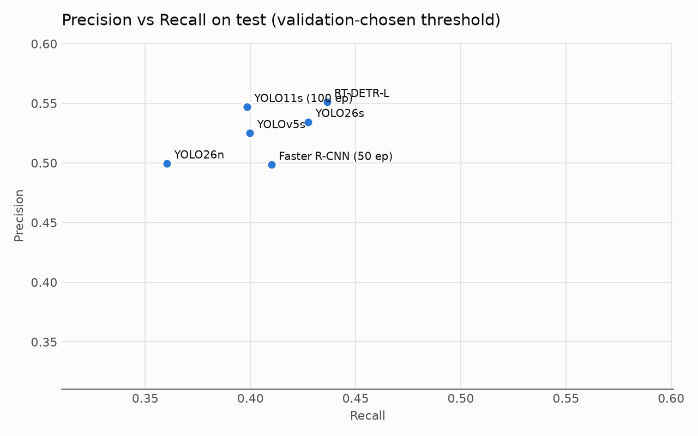</td>
<td>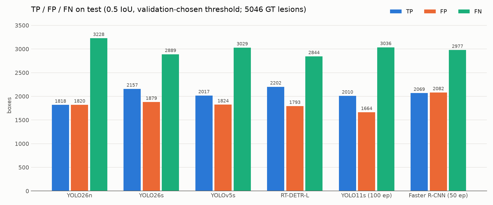</td>
</tr>
<tr>
<td>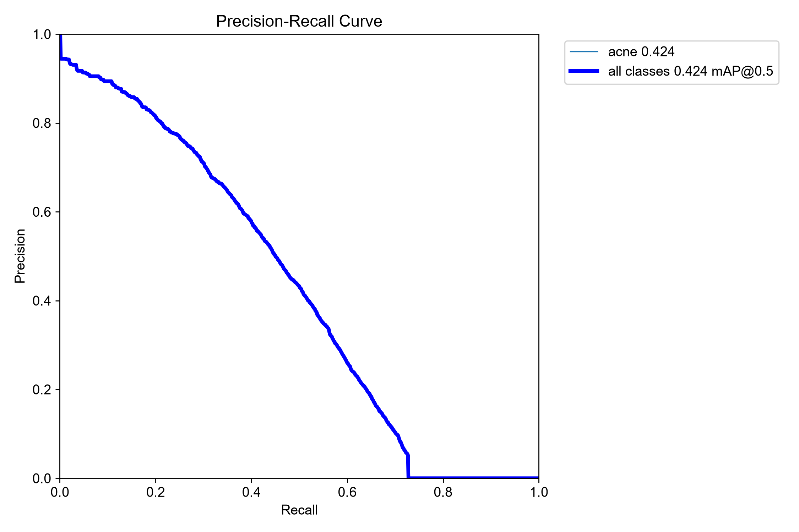</td>
<td>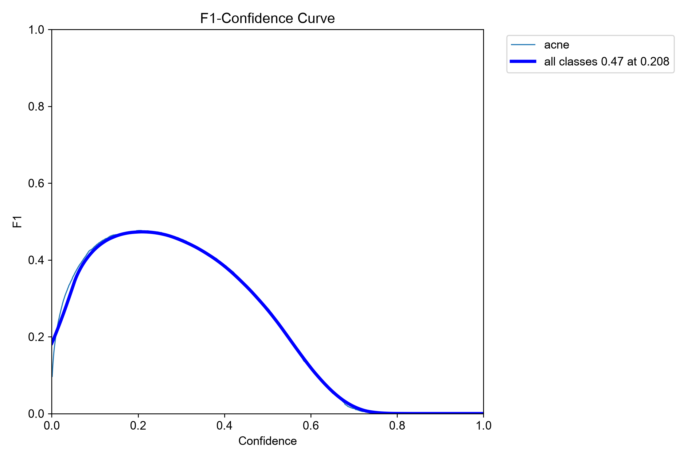</td>
</tr>
<tr>
<td align="center" colspan="2"><i>Hình 8. Precision–Recall, TP/FP/FN, và đường PR, F1–confidence của YOLO26s trên test.</i></td>
</tr>
</table>

### 5.8 Thử nghiệm độ phân giải 1280 và model cuối

Hơn một nửa số nốt mụn nhỏ hơn 8 px ở đầu vào 640, và recall ở nhóm dưới 5 px chỉ đạt 12%. Vì vậy 3 model hòa điểm được train lại ở **1280**. Mỗi model giữ cấu hình đại diện của nó, cùng split và cùng evaluator; batch được giảm để vừa 8 GB VRAM (RT-DETR-L: batch 2).

| Model (test) | mAP50-95 | mAP50 | Recall | Precision | F1 | Latency | MB |
|---|---:|---:|---:|---:|---:|---:|---:|
| **RT-DETR-L @1280** ✅ | 0,191 | **0,528** | **0,511** | **0,607** | **0,555** | 78 ms | 63 |
| YOLO26s @1280 | **0,194** | 0,507 | 0,480 | 0,594 | 0,531 | 24 ms | 19 |
| YOLO11s @1280 | 0,187 | 0,509 | 0,486 | 0,597 | 0,536 | 22 ms | 18 |
| YOLO26s @640 | 0,148 | 0,424 | 0,427 | 0,534 | 0,475 | 10 ms | 19 |

Trên validation, ba model hòa nhau về mAP50-95 (cách nhau ≤ 0,002) và RT-DETR-L có Recall cao nhất, nên được chọn. Trên test, Recall (+0,032 [+0,007; +0,056]) và F1 (+0,024 [+0,006; +0,042]) của nó hơn YOLO26s @1280 có ý nghĩa thống kê; mAP50-95 thì hòa. Model triển khai là `models/phase1/best_acne_detector.pt`; bản YOLO26s @640 được giữ lại. Phương án dự phòng nhẹ là YOLO26s @1280. RT-DETR-L kém hơn trên ảnh độ phân giải thấp, nên ảnh đầu vào cần có cạnh dài ≥ 1500 px. Chi tiết: [reports/phase1_resolution_study.md](reports/phase1_resolution_study.md).

## 6. Thảo luận

**Vì sao chọn YOLO26s?**

| Tiêu chí | YOLO26s | RT-DETR-L |
|---|---|---|
| mAP50-95 test | **0,148** | 0,143 (không khác có ý nghĩa) |
| Recall / F1 test | 0,428 / 0,475 | **0,436 / 0,487** (không khác có ý nghĩa) |
| Ảnh > 60 nốt | **0,409** | 0,383 |
| Giới hạn box/ảnh | 500 | **300** |
| Latency | **10,8 ms** | 28,4 ms |
| Kích thước | **19 MB** | 63 MB |
| VRAM khi train | thấp | 6,9 GB (sát giới hạn 8 GB) |

Khi chất lượng không phân biệt được, các tiêu chí triển khai và độ ổn định quyết định. YOLO26s nhẹ hơn, nhanh hơn, ổn định hơn ở ca mụn nặng và dễ train lại trên phần cứng hiện có. RT-DETR-L là phương án dự phòng hợp lý nếu dữ liệu mới cho thấy lợi thế Recall của nó là thật.

**Vì sao mAP50-95 thấp (≈ 0,15) dù mAP50 ≈ 0,42?** Với nốt ~8 px, box lệch 1–2 px đã làm IoU giảm mạnh. Model định vị được nốt mụn, nhưng box chưa khớp chặt ở các ngưỡng IoU cao.

**Các lỗi thường gặp.**
- *Sót (FN)* tập trung ở ảnh mụn nặng, nốt nhỏ, sát và chồng lên nhau; tuỳ model chỉ bắt được 16–52% số nốt trên 5 ảnh khó nhất.
- *Báo sai (FP)* cũng nhiều ở các ảnh này. Một phần có thể là nốt thật chưa được gán nhãn, cần review thủ công.
- Level 3 chỉ có 9 ảnh train, nên mọi model đều yếu ở nhóm khách hàng có mụn nặng nhất.

Ảnh minh hoạ lỗi nằm ở `reports/phase1_additional_models/common_eval/<model>/failure_cases_test/` (không đưa vào README vì là ảnh khuôn mặt).

**FP theo vùng.** Trong 1.414 detection của YOLO26s không khớp nhãn trên test, chỉ 4,7% nằm ở vùng nhạy cảm: mắt 5, môi 17, nốt ruồi 7, tóc/lông mày/râu 38. Còn lại 91% nằm trên da mặt, nhiều trường hợp trông như nốt mụn nhỏ bị bỏ sót khi gán nhãn. Ngoài ra 2,5% nằm ngoài mặt (nền, thước đo).

**Ảnh ngoài dataset.** Trên 19 ảnh điện thoại, model đạt có điều kiện: bắt được nốt mụn thật khi ảnh chụp gần, rõ nét và cạnh dài ≥ ~1500 px; không nhận nhầm nốt ruồi; không sinh box trên ảnh da sạch. Model vẫn sót nhiều nốt sẩn nhỏ ở trán và không dùng được với ảnh nhỏ hơn khoảng 700 px.

Tổng hợp và checklist nghiệm thu: [reports/phase1_extended_benchmark.md](reports/phase1_extended_benchmark.md).

## 7. Hạn chế

- **Một seed** cho mỗi model; kết luận dựa trên CI bootstrap theo ảnh, chưa tính dao động giữa các lần train.
- **Ngân sách tuning không đều**: model mới có 3 cấu hình, model cũ có 1. Thực nghiệm cho thấy ảnh hưởng nhỏ với họ YOLO (YOLOv5s: 0,1422 so với 0,1427).
- **Split không phân tầng theo mức độ mụn và không theo người**: level 3 phân bố lệch giữa các split; chưa kiểm soát cùng một người xuất hiện ở nhiều split.
- **Ảnh camera thực tế còn ít**: 19 ảnh ngoài dataset, chưa có nhãn chuyên gia, nên chỉ đánh giá định tính ([phase1_camera_review.md](reports/phase1_camera_review.md)).
- **Rà soát vùng FP**: các nhóm mắt, môi, nốt ruồi, tóc/râu đã được xem tay toàn bộ; nhóm "khác" (95%) mới xem theo mẫu.
- Faster R-CNN dùng augmentation nhẹ hơn và NMS mặc định (0,5); YOLOv5s là biến thể `yolov5su`; RT-DETR dùng bản L thay vì R18.
- Latency đo trên một laptop: thứ tự tương đối đáng tin hơn giá trị tuyệt đối.

## 8. Hướng phát triển

1. ~~Tăng độ phân giải~~: đã làm ở 1280 (§5.8). Bước tiếp theo là **chia ảnh thành ô** (tiling/SAHI) để giữ nguyên độ phân giải gốc cho nốt dưới 5 px.
2. **Review nhãn** các FP lặp lại để phát hiện nốt bị bỏ sót khi gán nhãn.
3. **Thêm dữ liệu mụn nặng** và chia phân tầng theo mức độ mụn.
4. **Nhiều seed** cho các model dẫn đầu, và đánh giá trên ảnh camera thực tế của spa.
5. Giai đoạn 2 (phân loại loại mụn) và Giai đoạn 3 (phân loại sẹo mụn), sau đó ghép thành Skin Profile.

## 9. Tái lập kết quả

### Cài đặt

```powershell
python -m venv venv
.\venv\Scripts\python.exe -m pip install torch torchvision --index-url https://download.pytorch.org/whl/cu128
.\venv\Scripts\python.exe -m pip install -r requirements-phase1-lock.txt
```

### Chuẩn bị dữ liệu và train 3 model gốc

Xem [scripts/phase1/README.md](scripts/phase1/README.md) để biết các bước: trích ảnh ACNE04, ghép nhãn ACNE04-v2, làm sạch, chia split, kiểm tra nhãn, smoke test và benchmark YOLO26n/26s/11s.

### Train và so sánh các detector bổ sung

```powershell
.\venv\Scripts\python.exe -u scripts\phase1\train_yolov5s.py
.\venv\Scripts\python.exe -u scripts\phase1\train_faster_rcnn.py                  # --full-schedule: bản đủ 50 epoch
.\venv\Scripts\python.exe -u scripts\phase1\train_rtdetr.py                       # --full-schedule: bản đủ 100 epoch
.\venv\Scripts\python.exe -u scripts\phase1\train_yolo11s_full100.py
.\venv\Scripts\python.exe -u scripts\phase1\benchmark_additional_models.py        # evaluator chung + bootstrap
.\venv\Scripts\python.exe -u scripts\phase1\benchmark_latency.py                  # nên bật Best performance
.\venv\Scripts\python.exe    scripts\phase1\plot_all_models_comparison.py
.\venv\Scripts\python.exe    scripts\phase1\make_readme_figures.py
```

Chạy nền theo hàng đợi: `.\scripts\phase1\launch_additional.ps1 -Scripts train_yolov5s.py,train_rtdetr.py`. Xem tiến độ: `.\venv\Scripts\python.exe scripts\phase1\check_additional_progress.py`.

### Nghiệm thu: FP theo vùng và ảnh ngoài dataset

```powershell
# Tải model MediaPipe vào models\phase1\face_tools\
curl -o models\phase1\face_tools\face_landmarker.task https://storage.googleapis.com/mediapipe-models/face_landmarker/face_landmarker/float16/latest/face_landmarker.task
curl -o models\phase1\face_tools\selfie_multiclass_256x256.tflite https://storage.googleapis.com/mediapipe-models/image_segmenter/selfie_multiclass_256x256/float32/latest/selfie_multiclass_256x256.tflite
.\venv\Scripts\python.exe scripts\phase1\evaluate_phase1.py --error-analysis       # tạo false_positive_region_review.csv
.\venv\Scripts\python.exe scripts\phase1\label_error_regions.py                    # gán vùng + contact sheet để xem tay
.\venv\Scripts\python.exe scripts\phase1\summarize_error_regions.py
.\venv\Scripts\python.exe scripts\phase1\predict_acne.py --source test_img     # imgsz/conf đọc từ model_metadata.json
```

### Thử nghiệm độ phân giải 1280 và chọn model cuối

```powershell
.\venv\Scripts\python.exe -u scripts\phase1\train_1280.py --model yolo26s --batch 4   # --smoke: đo VRAM/tốc độ trước
.\venv\Scripts\python.exe -u scripts\phase1\train_1280.py --model yolo11s --batch 4
.\venv\Scripts\python.exe -u scripts\phase1\train_1280.py --model rtdetr --batch 2
.\venv\Scripts\python.exe -u scripts\phase1\compare_resolution.py                    # YOLO26s 640 vs 1280
.\venv\Scripts\python.exe -u scripts\phase1\compare_1280.py                          # chọn trên val, bootstrap, latency
.\venv\Scripts\python.exe    scripts\phase1\promote_detector.py                      # cài model cuối, giữ bản cũ
```

### Cấu trúc repository

```text
BinSpa_AI/
├── scripts/phase1/
│   ├── common.py, split_phase1.py, convert_v2_to_yolo.py …   # chuẩn bị dữ liệu
│   ├── train_phase1.py                                         # YOLO26n/26s/11s
│   ├── train_yolov5s.py, train_rtdetr.py, train_ultralytics_common.py
│   ├── train_faster_rcnn.py                                    # Dataset adapter + vòng train PyTorch
│   ├── evaluate_detector_common.py                             # evaluator chung, bootstrap
│   ├── benchmark_additional_models.py, benchmark_latency.py
│   └── plot_all_models_comparison.py, make_readme_figures.py
├── reports/
│   ├── phase1_extended_benchmark.md                            # báo cáo cuối GĐ1 + checklist nghiệm thu
│   ├── phase1_resolution_study.md                              # 640 vs 1280 và chọn model cuối
│   ├── phase1_camera_review.md                                 # nghiệm thu ảnh ngoài dataset
│   ├── phase1_summary.md                                       # báo cáo 3 model gốc
│   ├── metrics/phase1_*.csv                                    # bảng số liệu
│   └── phase1_additional_models/
│       ├── README.md                                           # chi tiết phương pháp
│       ├── final_comparison.md                                 # so sánh & kết luận
│       └── <model>/  common_eval/  charts/
├── docs/figures/                                               # hình trong README
├── datasets/  models/  runs/                                   # không đưa lên git
└── requirements-phase1*.txt
```

Weights (`models/`, `runs/`) và dữ liệu (`datasets/`, `raw/`) không nằm trong git.

## 10. Giấy phép dữ liệu và đạo đức

- **ACNE04 chỉ được dùng cho học thuật** (license `acne04-academic-use-only`, xem [xpwu95/LDL](https://github.com/xpwu95/LDL)). Model trong repo này được train trên ACNE04-v2, nên **cần kiểm tra pháp lý hoặc train lại trên dữ liệu có quyền sử dụng thương mại** trước khi đưa vào dịch vụ của Bin Spa.
- Ảnh khuôn mặt là dữ liệu sinh trắc học nhạy cảm. Repository không công bố ảnh khuôn mặt; hệ thống thật cần có sự đồng ý rõ ràng của khách hàng và không lưu ảnh lâu hơn mức cần thiết.
- Kết quả được trình bày dưới dạng "dấu hiệu phát hiện / mức tin cậy / gợi ý chăm sóc", **không** khẳng định bệnh lý.

## 11. Tài liệu tham khảo

1. X. Wu, N. Wen, J. Liang, Y.-K. Lai, D. She, M.-M. Cheng, J. Yang. *Joint Acne Image Grading and Counting via Label Distribution Learning.* ICCV 2019.
2. L. Gazeau, H. Nguyen, Z. Nguyen, M. Lebedeva, T. Nguyen, T.-D. To, J. Le Digabel, J. Filiol, G. Josse, C. Perlis, J. Wolfe. *AcneAI: A New Acne Severity Assessment Method Using Digital Images and Deep Learning.* MICCAI 2024, pp. 68–78.
3. S. Ren, K. He, R. Girshick, J. Sun. *Faster R-CNN: Towards Real-Time Object Detection with Region Proposal Networks.* NeurIPS 2015.
4. T.-Y. Lin, P. Dollár, R. Girshick, K. He, B. Hariharan, S. Belongie. *Feature Pyramid Networks for Object Detection.* CVPR 2017.
5. Y. Zhao, W. Lv, S. Xu, J. Wei, G. Wang, Q. Dang, Y. Liu, J. Chen. *DETRs Beat YOLOs on Real-time Object Detection.* CVPR 2024.
6. G. Jocher et al. *Ultralytics YOLO* (YOLOv5, YOLO11, YOLO26). https://github.com/ultralytics/ultralytics
7. B. Efron, R. J. Tibshirani. *An Introduction to the Bootstrap.* Chapman & Hall, 1993.

---

<sub>Kết quả phân tích hình ảnh chỉ mang tính tham khảo chăm sóc da. Bin Spa · Giai đoạn 1.</sub>
