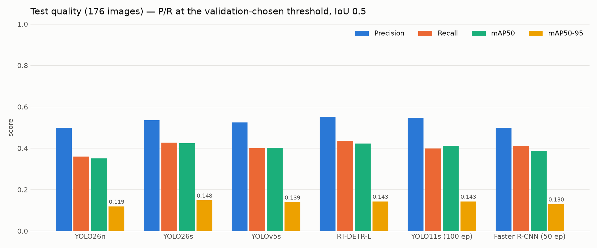
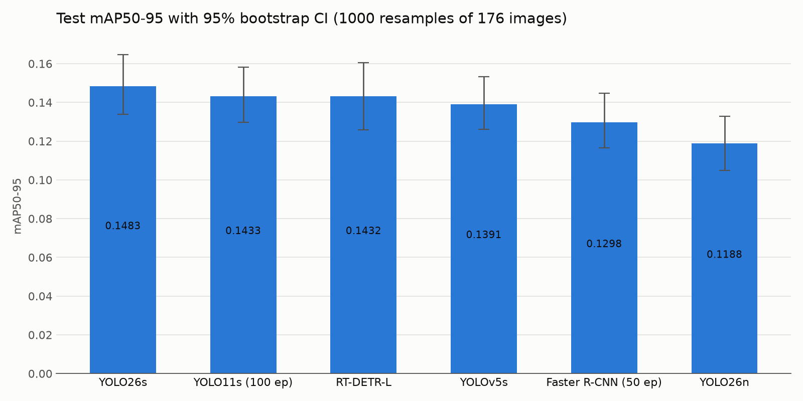
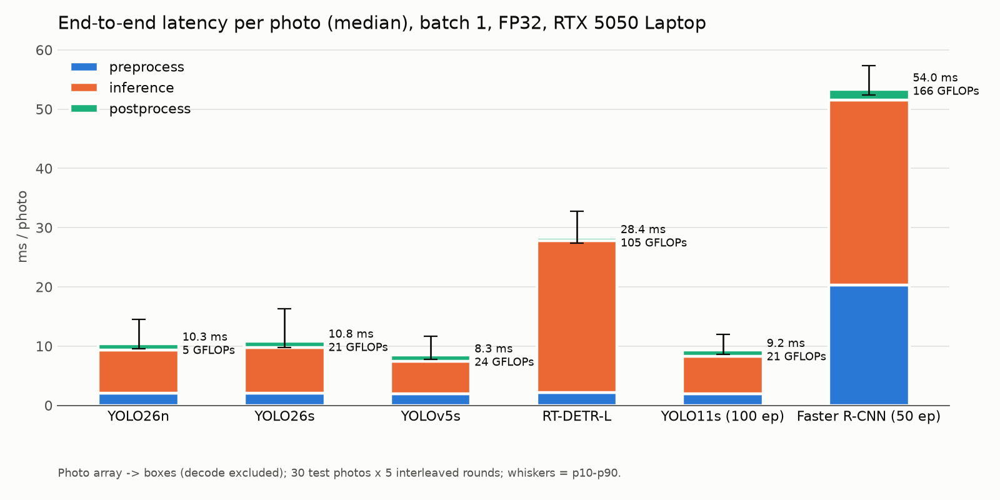
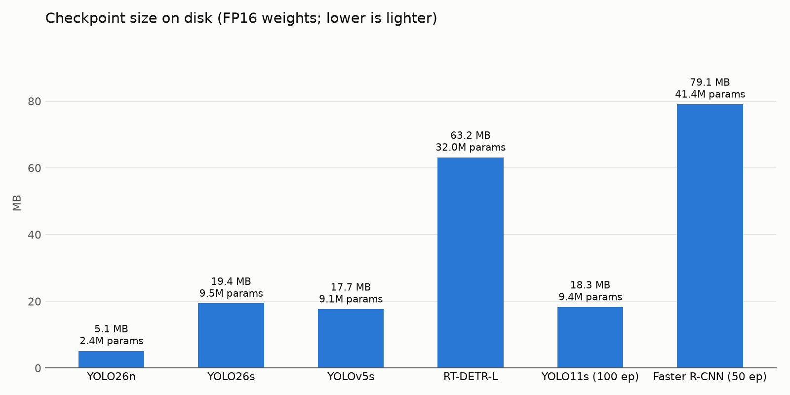
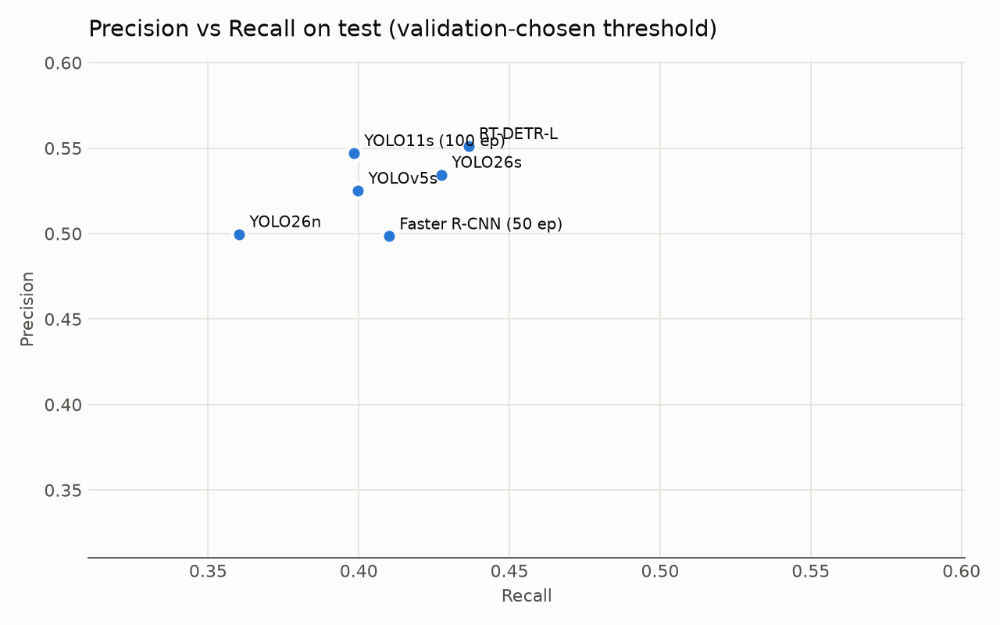
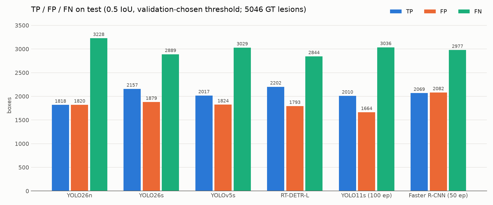

# So sánh cuối 6 detector — Giai đoạn 1 (phát hiện vị trí mụn)

Cùng dataset `acne04v2-clean-v1`, cùng split 816/175/176 (seed 42), cùng evaluator, cùng phiên đo latency. Cách train/đánh giá chi tiết: [README.md](README.md).

**Kết luận ngắn:** YOLO26s vẫn là lựa chọn phù hợp nhất cho Bin Spa. Không model mới nào vượt YOLO26s một cách có ý nghĩa thống kê. RT-DETR-L ngang chất lượng (nhỉnh hơn nhẹ về Recall/F1 nhưng không có ý nghĩa thống kê), song chậm hơn ~2,6×, nặng hơn ~3×, và bị giới hạn 300 dự đoán/ảnh — làm sót nhiều hơn ở ca mụn dày đặc.

## 1. Bảng chính — TEST (176 ảnh, 5.046 lesion)

P/R/F1/TP/FP/FN tại ngưỡng confidence chọn trên **validation**, IoU 0,5. mAP không phụ thuộc ngưỡng. Latency: end-to-end mỗi ảnh (ảnh gốc → box), batch 1, FP32, RTX 5050 Laptop.

| Model | Precision | Recall | F1 | mAP50 | mAP50-95 [CI 95%] | Latency ms | GPU ms | Size MB | TP | FP | FN |
|---|---|---|---|---|---|---|---|---|---|---|---|
| **YOLO26s** | 0,534 | 0,428 | 0,475 | **0,424** | **0,148** [0,134–0,165] | 10,8 | 6,5 | 19,4 | 2157 | 1879 | 2889 |
| YOLO11s ¹ | 0,547 | 0,398 | 0,461 | 0,412 | 0,143 [0,130–0,158] | 9,2 | 5,3 | 18,3 | 2010 | **1664** | 3036 |
| RT-DETR-L | **0,551** | **0,436** | **0,487** | 0,422 | 0,143 [0,126–0,161] | 28,4 | 25,1 | 63,2 | **2202** | 1793 | **2844** |
| YOLOv5s | 0,525 | 0,400 | 0,454 | 0,402 | 0,139 [0,126–0,153] | **8,3** | **4,8** | 17,7 | 2017 | 1824 | 3029 |
| Faster R-CNN R50-FPN ² | 0,498 | 0,410 | 0,450 | 0,388 | 0,130 [0,117–0,145] | 54,0 | 32,3 | 79,1 | 2069 | 2082 | 2977 |
| YOLO26n | 0,500 | 0,360 | 0,419 | 0,351 | 0,119 [0,105–0,133] | 10,3 | 6,5 | **5,1** | 1818 | 1820 | 3228 |

¹ Run đủ 100 epoch (bản cũ dừng ở epoch 77: test mAP50-95 0,145). ² Run đủ 50 epoch (bản 29 epoch: 0,131). Bản đại diện của mỗi kiến trúc được chọn bằng **val** mAP50-95. Bảng đủ 9 run: `reports/metrics/phase1_all_models_comparison_all_runs.csv`.

Thông số triển khai bổ sung:

| Model | Tham số (M) | GFLOPs @640 | VRAM suy luận | VRAM train | Giới hạn box/ảnh |
|---|---|---|---|---|---|
| YOLO26n | 2,4 | 5,3 | ~0,8 GB | (không ghi) | 500 |
| YOLO26s | 9,5 | 20,8 | ~0,8 GB | (không ghi) | 500 |
| YOLO11s | 9,4 | 21,4 | ~0,8 GB | (không ghi) | 500 |
| YOLOv5s | 9,1 | 23,8 | ~0,8 GB | 2,8 GB | 500 |
| RT-DETR-L | 32,0 | 105,3 | ~0,8 GB | 6,9 GB | **300** |
| Faster R-CNN | 41,4 | 166,1 | ~0,95 GB | 4,6 GB (batch 4) | 500 |

Kích thước = checkpoint FP16 trên đĩa. VRAM suy luận = bộ nhớ PyTorch cấp phát tối đa ở batch 1.

## 2. VALIDATION (dùng để chọn, 175 ảnh)

| Model | Precision | Recall | F1 | mAP50 | mAP50-95 | Ngưỡng conf |
|---|---|---|---|---|---|---|
| YOLO11s (100 ep) | 0,539 | 0,409 | 0,465 | 0,422 | **0,1566** | 0,249 |
| YOLO26s | 0,535 | 0,429 | 0,476 | **0,434** | 0,1557 | 0,212 |
| RT-DETR-L | 0,538 | **0,455** | **0,493** | 0,430 | 0,1557 | 0,474 |
| YOLOv5s | 0,543 | 0,411 | 0,468 | 0,418 | 0,1496 | 0,215 |
| Faster R-CNN (50 ep) | 0,511 | 0,421 | 0,461 | 0,406 | 0,1405 | 0,637 |
| YOLO26n | 0,493 | 0,370 | 0,423 | 0,361 | 0,1308 | 0,224 |

Áp quy tắc chọn đã đặt trước (mAP50-95 → nếu sát thì Recall → nếu vẫn sát thì latency): 3 model đầu cách nhau < 0,001 mAP50-95 (hoà) → Recall cao nhất là **RT-DETR-L** (0,455). Đây là kết quả của quy tắc *chọn checkpoint/cấu hình*; quyết định model triển khai còn xét nhóm Deployment ở mục 5.

## 3. Chênh lệch có thật không? (bootstrap ghép cặp trên test, so với YOLO26s)

| So với YOLO26s | Δ mAP50-95 [CI 95%] | Δ Recall [CI 95%] | Δ F1 [CI 95%] | Kết luận |
|---|---|---|---|---|
| RT-DETR-L | −0,005 [−0,012; +0,002] | +0,009 [−0,010; +0,029] | +0,012 [−0,004; +0,028] | **không khác biệt có ý nghĩa** |
| YOLO11s (100 ep) | −0,005 [−0,011; +0,000] | **−0,029 [−0,046; −0,015]** | **−0,014 [−0,029; −0,001]** | recall, F1 **kém hơn rõ** |
| YOLOv5s | **−0,009 [−0,016; −0,003]** | **−0,028 [−0,042; −0,014]** | **−0,021 [−0,034; −0,009]** | **kém hơn rõ** |
| Faster R-CNN (50 ep) | **−0,018 [−0,027; −0,010]** | −0,016 [−0,043; +0,010] | **−0,025 [−0,043; −0,006]** | mAP50-95, F1 **kém hơn rõ** |
| YOLO26n | **−0,030 [−0,036; −0,025]** | **−0,067 [−0,081; −0,054]** | **−0,056 [−0,068; −0,044]** | **kém hơn rõ** |

Dữ liệu: `common_eval/bootstrap_test_vs_yolo26s.json` và `common_eval/bootstrap_test.json` (mốc = model đứng đầu val mAP50-95). Với 176 ảnh test, khoảng tin cậy của mAP50-95 rộng khoảng ±0,015, nên mọi chênh lệch < ~0,005 giữa các model dẫn đầu là không phân biệt được.

## 4. Biểu đồ

| | |
|---|---|
|  |  |
|  |  |
|  |  |

Confusion matrix và các đường PR/P/R/F1 của từng model: `common_eval/<model>/eval_test/`.

## 5. Đánh giá theo 2 nhóm

**Detection quality.** Nhóm dẫn đầu (không phân biệt được thống kê): YOLO26s, RT-DETR-L, YOLO11s về mAP50-95; YOLO26s và RT-DETR-L về Recall/F1. YOLOv5s, Faster R-CNN và YOLO26n kém hơn YOLO26s có ý nghĩa thống kê.

**Theo mật độ mụn** (recall trên test, ngưỡng vận hành):

| Lesion/ảnh (số ảnh) | YOLO26s | RT-DETR-L | YOLO11s | YOLOv5s | Faster R-CNN | YOLO26n |
|---|---|---|---|---|---|---|
| 1–10 (45) | 0,470 | **0,500** | 0,463 | 0,433 | 0,463 | 0,393 |
| 11–30 (78) | 0,417 | 0,466 | 0,405 | 0,392 | **0,476** | 0,374 |
| 31–60 (40) | 0,445 | **0,447** | 0,422 | 0,408 | 0,423 | 0,378 |
| > 60 (13) | **0,409** | 0,383 | 0,352 | 0,391 | 0,318 | 0,320 |

Trên ảnh dày nhất `levle3_89.jpg` (434 lesion), số lesion phát hiện đúng: YOLO26s 118, YOLOv5s 116, YOLO11s 111, YOLO26n 90, **RT-DETR-L 81** (bị chặn bởi 300 query), Faster R-CNN 68. RT-DETR-L tốt ở ảnh ít/vừa mụn nhưng giảm ở ca nặng — đúng nhóm khách hàng quan trọng của spa.

**Deployment.**
- *Latency*: mọi model YOLO 8–11 ms/ảnh; RT-DETR-L 28 ms; Faster R-CNN 54 ms (trong đó ~20 ms là thu nhỏ ảnh trên CPU). Với luồng "chụp ảnh → gửi lên → phân tích", tất cả đều nhanh hơn nhiều so với thời gian upload (~1–3 s), nên latency **không** là yếu tố loại model nào; nó ảnh hưởng chi phí server khi tải lớn (RT-DETR-L cần ~2,6× GPU so với YOLO26s cho cùng lưu lượng).
- *Kích thước*: YOLO 5–19 MB; RT-DETR-L 63 MB; Faster R-CNN 79 MB.
- *VRAM*: suy luận đều < 1 GB. Train RT-DETR-L cần ~6,9 GB (sát giới hạn 8 GB, khó tăng độ phân giải để cải thiện lesion nhỏ).
- *Độ ổn định*: YOLO26s ổn định giữa các mật độ; RT-DETR-L có trần 300 box/ảnh; Faster R-CNN phụ thuộc pipeline resize (đã phát hiện lỗi antialias khi đánh giá) và nhiều FP hơn ở ảnh ít mụn.

## 6. Failure cases

- **Sót nhiều nhất (FN)** ở các ảnh mụn nặng, dày đặc (`levle3_89`, `levle2_122`, `levle3_115`, `levle3_132`, `levle2_158`): lesion nhỏ, sát nhau, chồng lấn; tuỳ model chỉ bắt được 16–52% lesion ở các ảnh này (ảnh 434 lesion: 16–27%).
- **Báo sai nhiều nhất (FP)** cũng ở ảnh dày đặc (`levle3_89`, `levle2_34`, `levle2_122`, `levle3_132`, `levle3_106`): một phần có thể là lesion thật chưa được gán nhãn, hoặc box lệch vài pixel so với nhãn (với lesion ~8 px, lệch 2 px đã làm IoU < 0,5).
- **mAP50-95 thấp (~0,15) so với mAP50 (~0,42)** ở mọi model: model tìm được vị trí mụn nhưng box chưa khớp chặt — đặc trưng của vật thể rất nhỏ ở độ phân giải 640.
- Ảnh minh hoạ: `common_eval/<model>/failure_cases_test/` và `common_eval/<model>/predictions_test/`.

## 7. Giới hạn của phép so sánh

Một seed/model; ngân sách tuning của 3 model mới lớn hơn 3 model cũ; Faster R-CNN dùng augmentation nhẹ hơn và NMS mặc định; YOLOv5s là biến thể `yolov5su`; latency đo trên laptop; chưa có ảnh camera thực tế; split không theo bệnh nhân. Chi tiết: [README.md §8](README.md#8-hạn-chế).

## 8. Trả lời câu hỏi

1. **YOLOv5s** (test): P 0,525 · R 0,400 · F1 0,454 · mAP50 0,402 · mAP50-95 0,139 · 8,3 ms/ảnh · 17,7 MB.
2. **Faster R-CNN R50-FPN** (test, bản 50 epoch): P 0,498 · R 0,410 · F1 0,450 · mAP50 0,388 · mAP50-95 0,130 · 54,0 ms/ảnh · 79,1 MB. (Bản 29 epoch: mAP50-95 0,131.)
3. **RT-DETR-L** (test): P 0,551 · R 0,436 · F1 0,487 · mAP50 0,422 · mAP50-95 0,143 · 28,4 ms/ảnh · 63,2 MB.
4. **Tốt nhất về mAP50-95**: trên test là **YOLO26s (0,148)**; trên val là YOLO11s 100 epoch (0,1566), sát nút YOLO26s và RT-DETR-L (0,1557). Ba model này **không khác biệt có ý nghĩa thống kê**.
5. **Recall cao nhất**: **RT-DETR-L** (test 0,436; val 0,455). Hơn YOLO26s (0,428) nhưng không có ý nghĩa thống kê; ở ảnh > 60 lesion thì YOLO26s cao hơn (0,409 vs 0,383).
6. **Nhanh nhất**: **YOLOv5s** (8,3 ms end-to-end; 4,8 ms GPU). YOLO11s 9,2 ms, YOLO26n 10,3 ms, YOLO26s 10,8 ms — các model YOLO gần như ngang nhau ở batch 1.
7. **Nhẹ nhất**: **YOLO26n** (5,1 MB; 2,4M tham số; 5,3 GFLOPs) — nhưng chất lượng thấp nhất.
8. **Phù hợp nhất với Bin Spa: YOLO26s.** Vì: (a) chất lượng thuộc nhóm dẫn đầu — mAP50 và mAP50-95 cao nhất trên test, recall/F1 không kém RT-DETR-L một cách có ý nghĩa và hơn YOLO11s rõ rệt; (b) ổn định nhất ở ca mụn nặng, không bị trần 300 box như RT-DETR-L; (c) 10,8 ms/ảnh, 19 MB, < 1 GB VRAM — rẻ để phục vụ và dễ train lại trên GPU 8 GB. Quy tắc chọn trên val chọn RT-DETR-L nhờ recall, nhưng lợi thế đó không được xác nhận trên test, trong khi chi phí triển khai và rủi ro ở ca nặng cao hơn — nên với ưu tiên "chất lượng trước, latency vẫn phải thực tế", YOLO26s là cân bằng tốt nhất. RT-DETR-L là phương án dự phòng đáng giữ nếu sau này có thêm dữ liệu cho thấy recall vượt trội.
9. **YOLO26s hiện tại có còn là lựa chọn tốt nhất không? Có.** Không model nào trong 5 model còn lại vượt nó có ý nghĩa thống kê trên bất kỳ chỉ số chất lượng nào, và nó không thua ở nhóm triển khai. Lưu ý: chất lượng tuyệt đối vẫn thấp (recall ~0,43 — sót hơn một nửa lesion; mAP50-95 ~0,15). Hướng cải thiện có khả năng hiệu quả hơn đổi kiến trúc: tăng độ phân giải hoặc chia ảnh thành ô (tiling) cho lesion ~8 px, review nhãn sót, thêm seed, và đánh giá trên ảnh camera thực tế trước khi đưa vào sản phẩm.

*Kết quả phân tích hình ảnh chỉ mang tính tham khảo chăm sóc da.*
